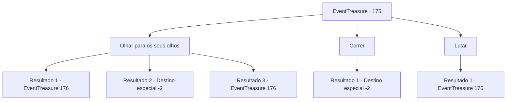

# Eventos de tesouro · 175

[Índice da tabela](index.md) · [Índice geral](../index.md)

ID: `pt:EventTreasure:175` · Fonte: `EventTreasure4` · Versão: 1.2.47.

Mapeamento estático dos arquivos; a disponibilidade e a execução dependem do estado da run.

## Texto do evento

*Sem texto no arquivo.*

## Dados de entrada

```json
{
  "id": 175,
  "grade": 1,
  "place": "",
  "required": ""
}
```

## Mapa das escolhas



## Escolhas e resultados

### Escolha 1

Olhar para os seus olhos

Requisitos e outros campos da escolha:

```json
{
  "required": ""
}
```

#### Resultado 1.1

Você olha diretamente nos olhos da serpente divina. E suporta sua pressão avassaladora. Então, a serpente divina abre a boca como se achasse divertido. 

 "Sim... Parece que você tem o necessário para enfrentar-me. Eu estive esperando por um humano como você."


Continuação registrada: [Evento 176](0176.md) na mesma tabela.

```json
{
  "required": "21_2_4|21_55_1",
  "chance": "1|0_14_1",
  "nextEvent": 176,
  "type": 0,
  "reward": ""
}
```

#### Resultado 1.2

Olhas fixamente nos olhos da serpente divina. No entanto, a pressão avassaladora começa a apertar o teu coração e desmaias com a respiração presa na garganta. Pouco depois de cair de joelhos, perdes a consciência e cais no chão. 

 "Que patético. Não tenho interesse em ti."

 A voz da serpente divina afasta-se lentamente dos teus ouvidos. Quando recuperas a consciência, percebes que foste expulso da selva. Levantas-te e limpas o suor frio. Depois começas a caminhar em direção a um lugar diferente.

Continuação registrada: [Destino especial `-2`](../destinos-especiais.md).

```json
{
  "required": "21_2_4|21_55_1",
  "chance": "18",
  "nextEvent": -2,
  "type": 1,
  "reward": "5_512_9"
}
```

#### Resultado 1.3

Você olha diretamente nos olhos da serpente divina. E suporta sua pressão avassaladora. Então, a serpente divina abre a boca como se achasse divertido. 

 "Sim... Parece que você tem o necessário para enfrentar-me. Eu estive esperando por um humano como você."


Continuação registrada: [Evento 176](0176.md) na mesma tabela.

```json
{
  "required": "-1|20_2_4|20_55_1",
  "chance": "1",
  "nextEvent": 176,
  "type": 2,
  "reward": ""
}
```

### Escolha 2

Correr

Requisitos e outros campos da escolha:

```json
{
  "required": ""
}
```

#### Resultado 2.1

Depois de recuar lentamente, você se vira e corre o mais rápido que pode. Então, depois de um tempo, você acaba saindo da selva.

Continuação registrada: [Destino especial `-2`](../destinos-especiais.md).

```json
{
  "required": "",
  "chance": "1",
  "nextEvent": -2,
  "type": 2,
  "reward": "5_512_9"
}
```

### Escolha 3

Lutar

Requisitos e outros campos da escolha:

```json
{
  "required": "-1|20_2_4|20_55_1"
}
```

#### Resultado 3.1

Depois de suportar a esmagadora pressão da serpente divina, você corre em direção a ela e balança sua espada. No entanto, seu ataque não atinge a serpente divina. Ele simplesmente passa por ela como uma espada cortando a água. A serpente divina olha para você com diversão e diz: 

 "Sim... Parece que você tem o necessário para enfrentar-me. Eu estive esperando por um humano como você."


Continuação registrada: [Evento 176](0176.md) na mesma tabela.

```json
{
  "required": "",
  "chance": "1",
  "nextEvent": 176,
  "type": 2,
  "reward": ""
}
```

## Referências que chegam a este evento

- [Evento 173 · escolha 1 · resultado 1](0173.md#escolha-1)
- [Evento 174 · escolha 1 · resultado 1](0174.md#escolha-1)
