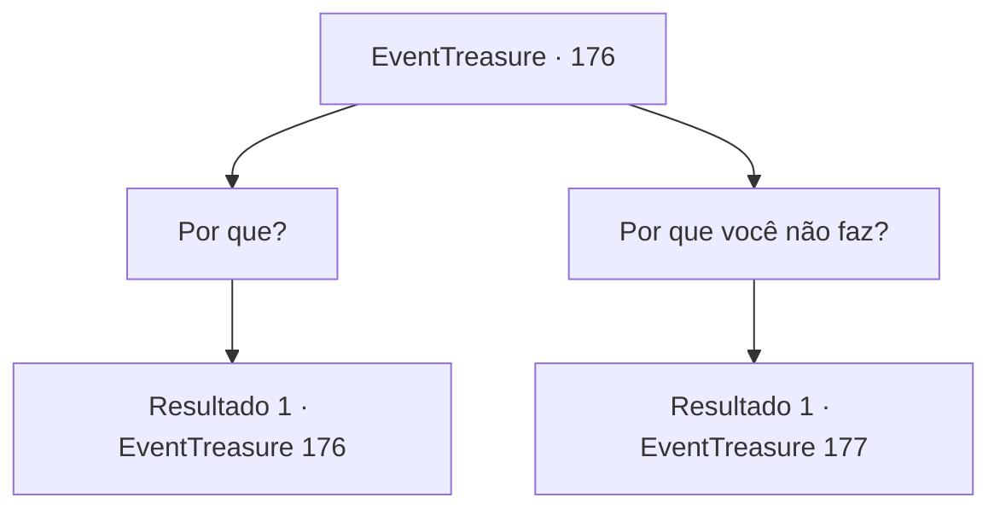

# Eventos de tesouro · 176

[Índice da tabela](index.md) · [Índice geral](../index.md)

ID: `pt:EventTreasure:176` · Fonte: `EventTreasure4` · Versão: 1.2.47.

Mapeamento estático dos arquivos; a disponibilidade e a execução dependem do estado da run.

## Texto do evento

*Sem texto no arquivo.*

## Dados de entrada

```json
{
  "id": 176,
  "grade": 1,
  "place": "",
  "required": ""
}
```

## Mapa das escolhas



## Escolhas e resultados

### Escolha 1

Por que?

Requisitos e outros campos da escolha:

```json
{
  "required": "5_532_0"
}
```

#### Resultado 1.1

O deus serpente fala enquanto move sua língua. 

 "Governo este lugar como protetor deste ecossistema. Mantenho o equilíbrio na pirâmide alimentar. No entanto, um dia algo começou a prejudicar o equilíbrio. Portanto, preciso de um ser poderoso que possa ajudar a manter esse equilíbrio."

 Ele te olha e diz que você parece um candidato forte para o papel.

Continuação registrada: [Evento 176](0176.md) na mesma tabela.

```json
{
  "required": "",
  "chance": "1",
  "nextEvent": 176,
  "type": 2,
  "reward": "5_532_1"
}
```

### Escolha 2

Por que você não faz?

Requisitos e outros campos da escolha:

```json
{
  "required": "5_532_1"
}
```

#### Resultado 2.1

O deus serpente responde à sua pergunta com decepção. 

 "Você está certo. Seria ótimo se eu pudesse fazer isso sozinho, no entanto, é difícil para mim intervir de forma mais direta porque recebi divindade. Por isso tantos deuses têm avatares. Nesse sentido, emprestarei minha força a você na esperança de que derrote os seres distorcidos."


Continuação registrada: [Evento 177](0177.md) na mesma tabela.

```json
{
  "required": "",
  "chance": "1",
  "nextEvent": 177,
  "type": 2,
  "reward": ""
}
```

## Referências que chegam a este evento

- [Evento 175 · escolha 1 · resultado 1](0175.md#escolha-1)
- [Evento 175 · escolha 1 · resultado 3](0175.md#escolha-1)
- [Evento 175 · escolha 3 · resultado 1](0175.md#escolha-3)
- [Evento 176 · escolha 1 · resultado 1](0176.md#escolha-1)
