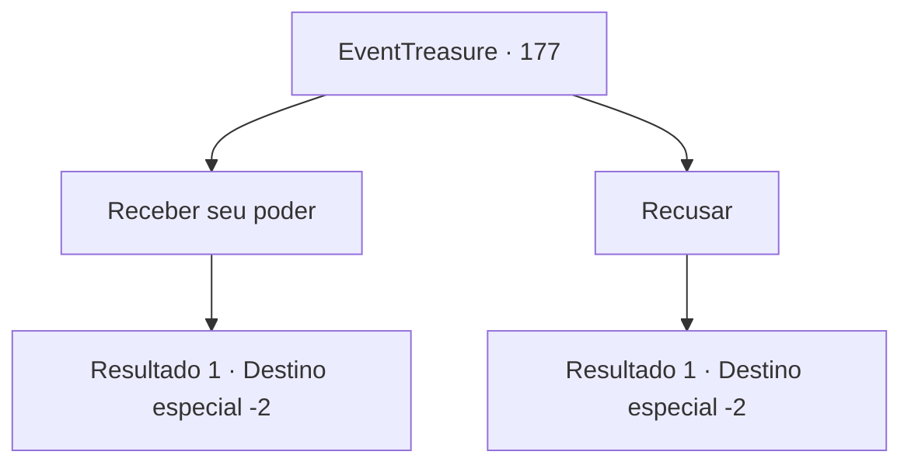

# Eventos de tesouro · 177

[Índice da tabela](index.md) · [Índice geral](../index.md)

ID: `pt:EventTreasure:177` · Fonte: `EventTreasure4` · Versão: 1.2.47.

Mapeamento estático dos arquivos; a disponibilidade e a execução dependem do estado da run.

## Texto do evento

*Sem texto no arquivo.*

## Dados de entrada

```json
{
  "id": 177,
  "grade": 1,
  "place": "",
  "required": ""
}
```

## Mapa das escolhas



## Escolhas e resultados

### Escolha 1

Receber seu poder

Requisitos e outros campos da escolha:

```json
{
  "required": ""
}
```

#### Resultado 1.1

Você aceita receber a força do deus serpente. Então os olhos do deus serpente se iluminaram novamente. A luz verde que fluía do deus serpente começa a se infiltrar em seu corpo. Você sente uma nova energia enquanto a pegajosa energia se infiltra em você. 

 "Você pode ir agora."

 O deus serpente que lhe deu nova força desapareceu na selva, e você começa a viajar para o próximo destino depois de sair da selva.

Continuação registrada: [Destino especial `-2`](../destinos-especiais.md).

```json
{
  "required": "",
  "chance": "1",
  "nextEvent": -2,
  "type": 2,
  "reward": "5_512_1|27_29_1|0_2_1"
}
```

### Escolha 2

Recusar

Requisitos e outros campos da escolha:

```json
{
  "required": ""
}
```

#### Resultado 2.1

Você diz que não receberá a força do deus serpente. Então o deus serpente geme e diz. 

 "Mmm... Claro. Entendo. Não vou impor. Você pode ir agora."

 Depois de dizer isso, o deus serpente desapareceu na selva. Então você começa a viajar em direção ao próximo destino depois de deixar a selva.

Continuação registrada: [Destino especial `-2`](../destinos-especiais.md).

```json
{
  "required": "",
  "chance": "1",
  "nextEvent": -2,
  "type": 2,
  "reward": "5_512_9"
}
```

## Referências que chegam a este evento

- [Evento 176 · escolha 2 · resultado 1](0176.md#escolha-2)
