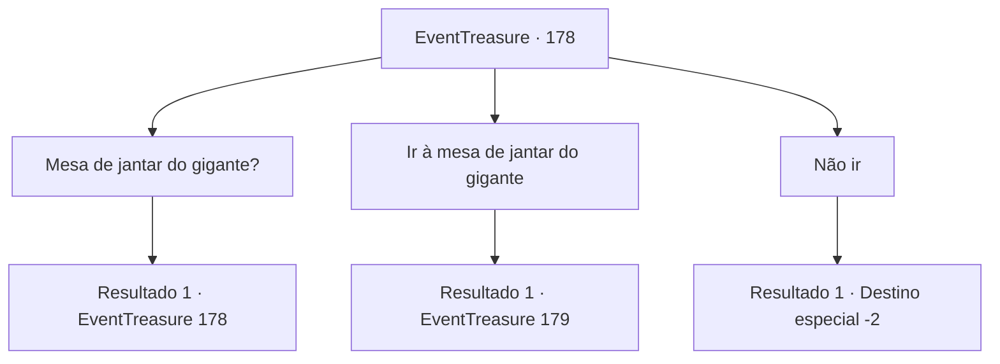

# Eventos de tesouro · 178

[Índice da tabela](index.md) · [Índice geral](../index.md)

ID: `pt:EventTreasure:178` · Fonte: `EventTreasure4` · Versão: 1.2.47.

Mapeamento estático dos arquivos; a disponibilidade e a execução dependem do estado da run.

## Texto do evento

Você passa por uma pequena vila cercada de pântanos chamada ‘Peullwia’. Parece que esta pequena aldeia barricada com simples cercas de madeira que ganha a vida vendendo cogumelos que crescem nos pântanos. Depois de observar os aldeões indo em direção aos pântanos com cestas na cabeça, você vê um velho homem fumando na entrada da vila e um quadro de avisos próximo a ele. Você se aproxima do quadro e lê as notícias. Tem pequenos pedaços de papel destacando-se, com a escrita pequena que parece ter sido escrito por um halfling 

 "Procurando por alguém que aceite a missão. Venha a Mesa de Jantar do Gigante."


## Dados de entrada

```json
{
  "id": 178,
  "grade": 2,
  "place": "",
  "required": "1_2_50|5_513_0|18_512_1|18_514_1|26_13_1"
}
```

## Mapa das escolhas



## Escolhas e resultados

### Escolha 1

Mesa de jantar do gigante?

Requisitos e outros campos da escolha:

```json
{
  "required": "5_517_0"
}
```

#### Resultado 1.1

Enquanto você está falando consigo mesmo, o idoso sentado ao lado do tabuleiro responde. 

 "É a rocha que está nas colinas do outro lado do pântano. Chama-se a mesa do gigante porque a grande rocha está colocada como uma mesa de jantar."

 O idoso também acrescenta que a mesa de jantar foi feita há milhares de anos.

Continuação registrada: [Evento 178](0178.md) na mesma tabela.

```json
{
  "required": "",
  "chance": "1",
  "nextEvent": 178,
  "type": 2,
  "reward": "5_517_1"
}
```

### Escolha 2

Ir à mesa de jantar do gigante

Requisitos e outros campos da escolha:

```json
{
  "required": "5_517_1"
}
```

#### Resultado 2.1

Decide ir até a 'mesa de jantar do gigante' localizada do outro lado do pântano. O pântano coberto de cogumelos verdes é firme e tem um cheiro agradável. Você atravessa o pântano, batendo nas esporas dos cogumelos voadores com as mãos. Então você descobre a mesa de jantar do gigante no topo da colina do outro lado do pântano. Ela se ergue alta no topo da colina como se estivesse olhando para baixo para o pântano.

Continuação registrada: [Evento 179](0179.md) na mesma tabela.

```json
{
  "required": "",
  "chance": "1",
  "nextEvent": 179,
  "type": 2,
  "reward": "5_513_1"
}
```

### Escolha 3

Não ir

Requisitos e outros campos da escolha:

```json
{
  "required": "5_517_1"
}
```

#### Resultado 3.1

Decide esquecer a mesa de jantar do gigante. Em seguida, você passa para o próximo destino.

Continuação registrada: [Destino especial `-2`](../destinos-especiais.md).

```json
{
  "required": "",
  "chance": "1",
  "nextEvent": -2,
  "type": 2,
  "reward": "5_513_9"
}
```

## Referências que chegam a este evento

- [Evento 178 · escolha 1 · resultado 1](0178.md#escolha-1)
