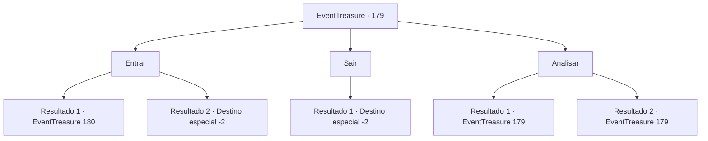

# Eventos de tesouro · 179

[Índice da tabela](index.md) · [Índice geral](../index.md)

ID: `pt:EventTreasure:179` · Fonte: `EventTreasure4` · Versão: 1.2.47.

Mapeamento estático dos arquivos; a disponibilidade e a execução dependem do estado da run.

## Texto do evento

*Sem texto no arquivo.*

## Dados de entrada

```json
{
  "id": 179,
  "grade": 1,
  "place": "",
  "required": ""
}
```

## Mapa das escolhas



## Escolhas e resultados

### Escolha 1

Entrar

Requisitos e outros campos da escolha:

```json
{
  "required": "5_518_1"
}
```

#### Resultado 1.1

Você entra em um espaço brilhante. Em seguida, o ambiente muda instantaneamente. Você percebe que está em uma floresta escura de coníferas com a luz fria da lua brilhando. Vagalumes e sementes de flores voam ao seu redor, e uma pequena fada aparece no meio delas. |drawing_grassfairy| Ela voa cuidadosamente ao seu redor. Você também observa a fada e vê que os nervos são visíveis através de sua pele transparente como uma folha e uma delicada luz verde emana do centro de seu corpo. A fada que voa ao redor da sua cabeça fala com você. 

 "Eu sou 'Elochin'. Tenho um problema, você pode me fazer um favor?"

 A fada continua enquanto agita suas asas parecidas com folhas. O aumento no número de seres distorcidos é um problema. Eu esperava que você nos protegesse... Claro, vou emprestar minha força para você.

Continuação registrada: [Evento 180](0180.md) na mesma tabela.

```json
{
  "required": "20_2_2",
  "chance": "1",
  "nextEvent": 180,
  "type": 2,
  "reward": ""
}
```

#### Resultado 1.2

Você se aventurou entre as rochas, mas uma sensação inexplicável de desconforto te faz recuar. A estrutura instável parece te afastar de alguma forma. No final, você se afasta da mesa de jantar do gigante.

Continuação registrada: [Destino especial `-2`](../destinos-especiais.md).

```json
{
  "required": "21_2_2",
  "chance": "1",
  "nextEvent": -2,
  "type": 2,
  "reward": "5_513_9"
}
```

### Escolha 2

Sair

Requisitos e outros campos da escolha:

```json
{
  "required": "5_518_2"
}
```

#### Resultado 2.1

Você está indo para um lugar diferente com a mesa de jantar do gigante atrás de você.

Continuação registrada: [Destino especial `-2`](../destinos-especiais.md).

```json
{
  "required": "",
  "chance": "1",
  "nextEvent": -2,
  "type": 2,
  "reward": "5_513_9"
}
```

### Escolha 3

Analisar

Requisitos e outros campos da escolha:

```json
{
  "required": "5_518_0"
}
```

#### Resultado 3.1

Você observa detalhadamente a mesa de jantar do gigante. Consegue decifrar com sucesso as antigas letras rúnicas gravadas na rocha em pé. E descobre que é um portal que leva a um espaço diferente, apesar de ser chamado de mesa de jantar. À medida que lê as letras gravadas na rocha, o espaço começa a brilhar.

Continuação registrada: [Evento 179](0179.md) na mesma tabela.

```json
{
  "required": "",
  "chance": "1|0_7_1",
  "nextEvent": 179,
  "type": 0,
  "reward": "5_518_1"
}
```

#### Resultado 3.2

Você observa a mesa de jantar do gigante em detalhes. Mas você não é capaz de aprender nenhuma outra informação.

Continuação registrada: [Evento 179](0179.md) na mesma tabela.

```json
{
  "required": "",
  "chance": "14",
  "nextEvent": 179,
  "type": 1,
  "reward": "5_518_2"
}
```

## Referências que chegam a este evento

- [Evento 178 · escolha 2 · resultado 1](0178.md#escolha-2)
- [Evento 179 · escolha 3 · resultado 1](0179.md#escolha-3)
- [Evento 179 · escolha 3 · resultado 2](0179.md#escolha-3)
