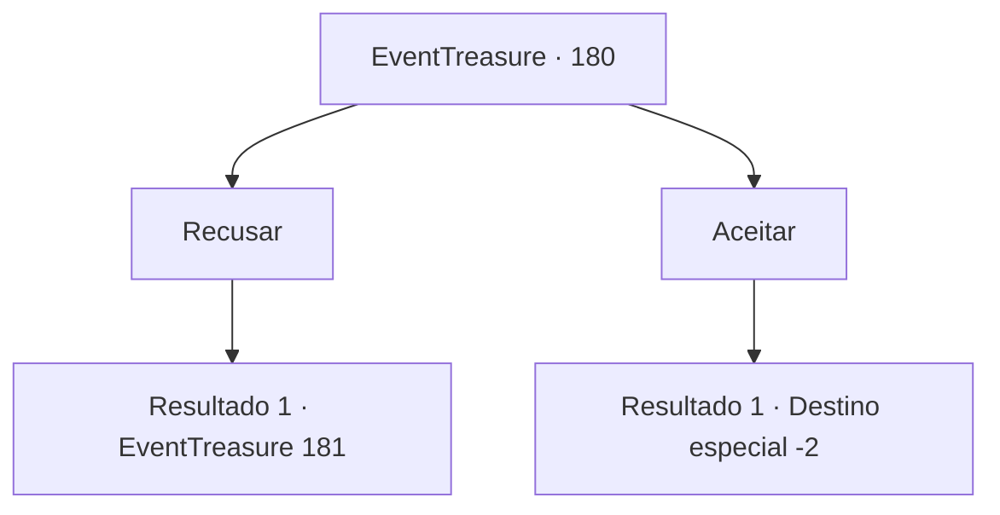

# Eventos de tesouro · 180

[Índice da tabela](index.md) · [Índice geral](../index.md)

ID: `pt:EventTreasure:180` · Fonte: `EventTreasure4` · Versão: 1.2.47.

Mapeamento estático dos arquivos; a disponibilidade e a execução dependem do estado da run.

## Texto do evento

*Sem texto no arquivo.*

## Dados de entrada

```json
{
  "id": 180,
  "grade": 1,
  "place": "",
  "required": ""
}
```

## Mapa das escolhas



## Escolhas e resultados

### Escolha 1

Recusar

Requisitos e outros campos da escolha:

```json
{
  "required": ""
}
```

#### Resultado 1.1

Você rejeita o pedido de Elochin. Em seguida, Elochin abaixa a cabeça e diz. 

 "Hmm... Então, por que você veio aqui?"

 Ele começa a falar consigo mesmo ao mesmo tempo. 

 "Hmm... O que devo fazer...?"

 Depois de pensar por um momento, Elochin te pergunta novamente. 

 "Eu garanto que você não vai se arrepender! Você não vai reconsiderar?"


Continuação registrada: [Evento 181](0181.md) na mesma tabela.

```json
{
  "required": "",
  "chance": "1",
  "nextEvent": 181,
  "type": 2,
  "reward": ""
}
```

### Escolha 2

Aceitar 

Requisitos e outros campos da escolha:

```json
{
  "required": ""
}
```

#### Resultado 2.1

Decide aceitar o pedido de Elochin. Elochin dá voltas ao redor da sua cabeça enquanto ri. 

 "Ha ha! Ótimo! Então!"

 Uma pequena aurora azul-verde dá voltas ao seu redor e desaparece como se estivesse se filtrando. E Elochin também desaparece ao mesmo tempo. Depois que Elochin foi embora, o espaço distorcido te cospe de volta para a mesa do gigante. Como se o que acabou de acontecer não fosse um sonho, você sente uma sensação estranha e uma energia abundante que se enraíza firmemente. Você estica seu corpo e se prepara para o próximo destino.

Continuação registrada: [Destino especial `-2`](../destinos-especiais.md).

```json
{
  "required": "",
  "chance": "1",
  "nextEvent": -2,
  "type": 2,
  "reward": "5_513_2|27_34_1|0_2_1"
}
```

## Referências que chegam a este evento

- [Evento 179 · escolha 1 · resultado 1](0179.md#escolha-1)
