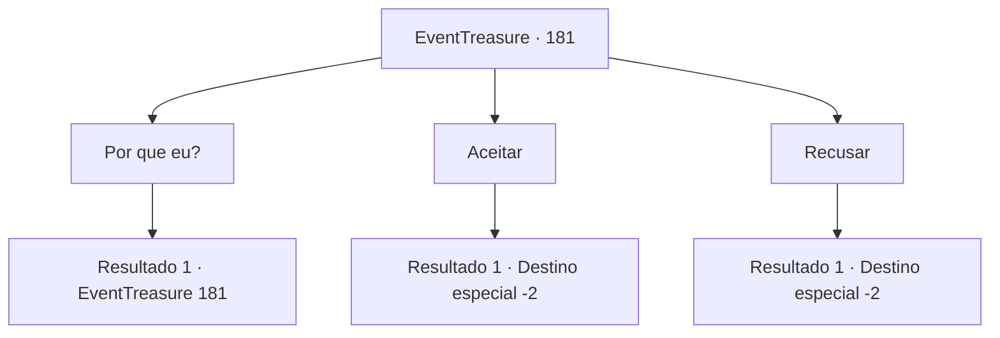

# Eventos de tesouro · 181

[Índice da tabela](index.md) · [Índice geral](../index.md)

ID: `pt:EventTreasure:181` · Fonte: `EventTreasure4` · Versão: 1.2.47.

Mapeamento estático dos arquivos; a disponibilidade e a execução dependem do estado da run.

## Texto do evento

*Sem texto no arquivo.*

## Dados de entrada

```json
{
  "id": 181,
  "grade": 1,
  "place": "",
  "required": ""
}
```

## Mapa das escolhas



## Escolhas e resultados

### Escolha 1

Por que eu?

Requisitos e outros campos da escolha:

```json
{
  "required": "5_519_0"
}
```

#### Resultado 1.1

Elochin responde à sua pergunta com uma voz suave. 

 "Gosto de você. Você parece forte, parece amigável e é inteligente o suficiente para chegar até aqui."


Continuação registrada: [Evento 181](0181.md) na mesma tabela.

```json
{
  "required": "",
  "chance": "1",
  "nextEvent": 181,
  "type": 2,
  "reward": "5_519_1"
}
```

### Escolha 2

Aceitar

Requisitos e outros campos da escolha:

```json
{
  "required": "5_519_1"
}
```

#### Resultado 2.1

Decide aceitar o pedido de Elochin. Elochin dá voltas ao redor da sua cabeça enquanto ri. 

 "Ha ha! Ótimo! Então!"

 Uma pequena aurora verde gira ao seu redor e desaparece como se estivesse se filtrando. E Elochin também desaparece ao mesmo tempo. Depois que Elochin foi embora, o espaço distorcido te joga de volta à mesa do gigante. Como se o que acabou de acontecer não fosse um sonho, você sente uma sensação estranha e uma energia abundante que se enraíza firmemente. Você estica seu corpo e se prepara para o próximo destino.

Continuação registrada: [Destino especial `-2`](../destinos-especiais.md).

```json
{
  "required": "",
  "chance": "1",
  "nextEvent": -2,
  "type": 2,
  "reward": "5_513_2|27_34_1|0_2_1"
}
```

### Escolha 3

Recusar

Requisitos e outros campos da escolha:

```json
{
  "required": "5_519_1"
}
```

#### Resultado 3.1

Você rejeita o pedido de Elochin. Elochin desaparece com um gemido lamentoso. Depois que Elochin foi embora, o espaço distorcido te joga de volta à mesa do gigante. O espaço distorcido na mesa do gigante desaparece. Você segue para o próximo destino com os montes de rochas atrás de você.

Continuação registrada: [Destino especial `-2`](../destinos-especiais.md).

```json
{
  "required": "",
  "chance": "1",
  "nextEvent": -2,
  "type": 2,
  "reward": "5_513_9"
}
```

## Referências que chegam a este evento

- [Evento 180 · escolha 1 · resultado 1](0180.md#escolha-1)
- [Evento 181 · escolha 1 · resultado 1](0181.md#escolha-1)
