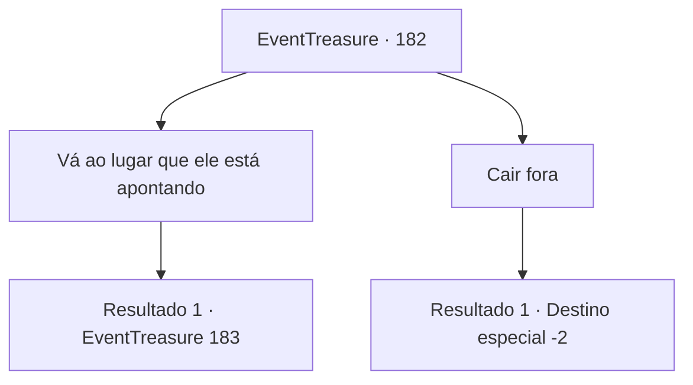

# Eventos de tesouro · 182

[Índice da tabela](index.md) · [Índice geral](../index.md)

ID: `pt:EventTreasure:182` · Fonte: `EventTreasure4` · Versão: 1.2.47.

Mapeamento estático dos arquivos; a disponibilidade e a execução dependem do estado da run.

## Texto do evento

Você caminha por um longo caminho com vista para o oceano. Quando você avista um pescador com a cara pálida, e ele grita para você suando frio. 

 "H-Huff! H-Há um... Um... Um Monstro!"

 Ele aponta para trás de você, e você rapidamente corre.

## Dados de entrada

```json
{
  "id": 182,
  "grade": 1,
  "place": "",
  "required": "1_2_50|5_514_0"
}
```

## Mapa das escolhas



## Escolhas e resultados

### Escolha 1

Vá ao lugar que ele está apontando 

Requisitos e outros campos da escolha:

```json
{
  "required": ""
}
```

#### Resultado 1.1

|drawing_octoFace| Quando você chega ao local para onde o pescador estava apontando, você encontra um monstro humanóide com uma cabeça de cefalópode agachado. Ele pega um pequeno caranguejo que rasteja pelo chão com seu braço parecido com um tentáculo. Depois de observá-lo aqui e ali, ele se transforma instantaneamente em um caranguejo gigante. O caranguejo gigante recém-criado se lança em sua direção com espuma na boca.

Continuação registrada: [Evento 183](0183.md) na mesma tabela.

```json
{
  "required": "",
  "chance": "1",
  "nextEvent": 183,
  "type": 2,
  "reward": "6_3_108|5_514_1",
  "place": 8
}
```

### Escolha 2

Cair fora

Requisitos e outros campos da escolha:

```json
{
  "required": ""
}
```

#### Resultado 2.1

Você se vira e corre para longe, assim como o pescador.

Continuação registrada: [Destino especial `-2`](../destinos-especiais.md).

```json
{
  "required": "",
  "chance": "1",
  "nextEvent": -2,
  "type": 2,
  "reward": "5_514_9"
}
```

## Referências que chegam a este evento

Nenhum `nextEvent` positivo da mesma tabela aponta para este nó. Isso não prova que seja inacessível: sorteio e estado de história podem selecioná-lo.

