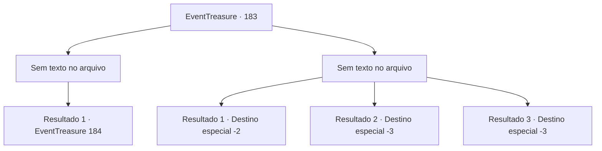

# Eventos de tesouro · 183

[Índice da tabela](index.md) · [Índice geral](../index.md)

ID: `pt:EventTreasure:183` · Fonte: `EventTreasure4` · Versão: 1.2.47.

Mapeamento estático dos arquivos; a disponibilidade e a execução dependem do estado da run.

## Texto do evento

*Sem texto no arquivo.*

## Dados de entrada

```json
{
  "id": 183,
  "grade": 1,
  "place": "",
  "required": ""
}
```

## Mapa das escolhas



## Escolhas e resultados

### Escolha 1

*Sem texto no arquivo; o papel dessa opção depende da interface do jogo.*

Requisitos e outros campos da escolha:

```json
{
  "required": ""
}
```

#### Resultado 1.1

O caranguejo gigante encurralado volta à sua forma original sem conseguir manter sua forma. O monstro com cabeça de polvo te encara enquanto sangra seu sangue roxo. Em seguida, estende todos os seus tentáculos para tentar te engolir.

Continuação registrada: [Evento 184](0184.md) na mesma tabela.

```json
{
  "required": "",
  "chance": "1",
  "nextEvent": 184,
  "type": 2,
  "reward": ""
}
```

### Escolha 2

*Sem texto no arquivo; o papel dessa opção depende da interface do jogo.*

Requisitos e outros campos da escolha:

```json
{
  "required": ""
}
```

#### Resultado 2.1

Corres montanha abaixo depois de evitar por pouco a gigantesca pinça. O caranguejo gigante para de te perseguir e vai embora.

Continuação registrada: [Destino especial `-2`](../destinos-especiais.md).

```json
{
  "required": "1_0_2|1_1_2",
  "chance": "1",
  "nextEvent": -2,
  "type": 2,
  "reward": "0_0_-1|0_1_-1|5_514_9"
}
```

#### Resultado 2.2

Depois que o caranguejo gigante te levanta com sua pinça e olha ao redor, ele te despedaça.

Continuação registrada: [Destino especial `-3`](../destinos-especiais.md).

```json
{
  "required": "2_0_2",
  "chance": "1",
  "nextEvent": -3,
  "type": 2,
  "reward": "0_0_-1|0_1_-1"
}
```

#### Resultado 2.3

Depois que o caranguejo gigante te levanta com sua pinça e olha ao redor, ele te despedaça.

Continuação registrada: [Destino especial `-3`](../destinos-especiais.md).

```json
{
  "required": "2_1_2",
  "chance": "1",
  "nextEvent": -3,
  "type": 2,
  "reward": "0_0_-1|0_1_-1"
}
```

## Referências que chegam a este evento

- [Evento 182 · escolha 1 · resultado 1](0182.md#escolha-1)
