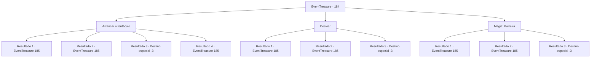

# Eventos de tesouro · 184

[Índice da tabela](index.md) · [Índice geral](../index.md)

ID: `pt:EventTreasure:184` · Fonte: `EventTreasure4` · Versão: 1.2.47.

Mapeamento estático dos arquivos; a disponibilidade e a execução dependem do estado da run.

## Texto do evento

*Sem texto no arquivo.*

## Dados de entrada

```json
{
  "id": 184,
  "grade": 1,
  "place": "",
  "required": ""
}
```

## Mapa das escolhas



## Escolhas e resultados

### Escolha 1

Arrancar o tentáculo

Requisitos e outros campos da escolha:

```json
{
  "required": ""
}
```

#### Resultado 1.1

Você arranca com força o tentáculo que envolve seu corpo. O sangue roxo espirra por todos os lados e a cabeça do polvo grita de dor. 

 "¡Kyeek!"

 Depois de se contorcer e inflar instantaneamente, ele se transforma em um gigante de fogo. Então ele corre em sua direção com um grito monstruoso.

Continuação registrada: [Evento 185](0185.md) na mesma tabela.

```json
{
  "required": "21_60_2",
  "chance": "1|0_5_1",
  "nextEvent": 185,
  "type": 0,
  "reward": "6_2_16",
  "place": 8
}
```

#### Resultado 1.2

Você não conseguiu se livrar do tentáculo que envolvia seu corpo. Depois de se levantar, ele te joga no chão. Seu corpo e cabeça tremem com o impacto, e você mal consegue se levantar. Enquanto isso, ele se transformou em um gigante de fogo antes que você percebesse. E te ataca com um grito monstruoso.

Continuação registrada: [Evento 185](0185.md) na mesma tabela.

```json
{
  "required": "21_60_2|1_0_2",
  "chance": "22",
  "nextEvent": 185,
  "type": 1,
  "reward": "6_0_16|0_0_-1",
  "place": 8
}
```

#### Resultado 1.3

Você não conseguiu arrancar o tentáculo que envolvia seu corpo. Depois de se levantar, ele envolve seu tentáculo ao redor de você e esmaga seu corpo. Com o som aterrorizante de ossos se quebrando, ele te empurra para a beira da morte com uma dor insuportável.

Continuação registrada: [Destino especial `-3`](../destinos-especiais.md).

```json
{
  "required": "21_60_2|2_0_2",
  "chance": "22",
  "nextEvent": -3,
  "type": 1,
  "reward": "0_0_-1"
}
```

#### Resultado 1.4

Você arranca com força o tentáculo que envolve seu corpo. O sangue roxo espirra por todos os lados e a cabeça do polvo grita de dor. 

 "¡Kyeek!"

 Depois de se contorcer e inflar instantaneamente, ele se transforma em um gigante de fogo. Em seguida, emite um grito monstruoso e começa a correr em sua direção.

Continuação registrada: [Evento 185](0185.md) na mesma tabela.

```json
{
  "required": "20_60_4",
  "chance": "1",
  "nextEvent": 185,
  "type": 2,
  "reward": "6_2_16",
  "place": 8
}
```

### Escolha 2

Desviar

Requisitos e outros campos da escolha:

```json
{
  "required": ""
}
```

#### Resultado 2.1

Esquive cada um dos tentáculos do monstro. Em seguida, depois de ficar muito irritado, ele se contorce, infla instantaneamente e se transforma em um gigante de fogo. Então, ele emite um grito monstruoso e começa a correr em sua direção.

Continuação registrada: [Evento 185](0185.md) na mesma tabela.

```json
{
  "required": "",
  "chance": "1|0_6_1",
  "nextEvent": 185,
  "type": 0,
  "reward": "6_0_16",
  "place": 8
}
```

#### Resultado 2.2

Depois de não conseguir desviar do tentáculo do monstro, ele se enrola ao redor do seu corpo. O tentáculo te levanta e te joga no chão. Depois de ser jogado no chão, você supera o impacto e se equilibra para ficar de pé. Enquanto isso, ele se transformou em um gigante de fogo antes que você perceba. E te ataca com um grito monstruoso.

Continuação registrada: [Evento 185](0185.md) na mesma tabela.

```json
{
  "required": "1_0_2",
  "chance": "15",
  "nextEvent": 185,
  "type": 1,
  "reward": "6_0_16|0_0_-1",
  "place": 8
}
```

#### Resultado 2.3

Depois de não conseguir desviar do tentáculo do monstro, ele se enrola ao redor do seu corpo. Depois de se levantar, ele envolve seu tentáculo ao redor de você e esmaga seu corpo. Com o terrível som de ossos se quebrando, ele te empurra para a beira da morte com uma dor insuportável.

Continuação registrada: [Destino especial `-3`](../destinos-especiais.md).

```json
{
  "required": "2_0_2",
  "chance": "15",
  "nextEvent": -3,
  "type": 1,
  "reward": "0_0_-1"
}
```

### Escolha 3

Magia: Barreira

Requisitos e outros campos da escolha:

```json
{
  "required": "1_1_2|20_0_2"
}
```

#### Resultado 3.1

Você rapidamente lança um feitiço para criar uma barreira. O tentáculo rebate contra a barreira, e a cabeça do polvo grita e começa a se contorcer pelo impacto. Em seguida, ele se transforma em um gigante de fogo. Ele avança em sua direção novamente com um grito monstruoso.

Continuação registrada: [Evento 185](0185.md) na mesma tabela.

```json
{
  "required": "",
  "chance": "1|0_14_1",
  "nextEvent": 185,
  "type": 0,
  "reward": "6_2_16|0_1_-1",
  "place": 8
}
```

#### Resultado 3.2

Tentas lançar um feitiço, mas o tentáculo foi mais rápido para te alcançar. O tentáculo te levanta e te golpeia contra o chão. Depois de ser golpeado contra o chão, você supera o impacto e se equilibra para ficar de pé. Enquanto isso, ele se transformou em um gigante de fogo antes que você perceba. E te ataca com um grito monstruoso.

Continuação registrada: [Evento 185](0185.md) na mesma tabela.

```json
{
  "required": "1_0_2",
  "chance": "20",
  "nextEvent": 185,
  "type": 1,
  "reward": "6_0_16|0_0_-1|0_1_-1",
  "place": 8
}
```

#### Resultado 3.3

Tentas lançar um feitiço, mas o tentáculo foi mais rápido para te alcançar. Depois de te agarrar, ele envolve seu tentáculo ao redor de você e esmaga seu corpo. Com o assustador som de ossos se quebrando, ele te empurra para a beira da morte com uma dor insuportável.

Continuação registrada: [Destino especial `-3`](../destinos-especiais.md).

```json
{
  "required": "2_0_2",
  "chance": "20",
  "nextEvent": -3,
  "type": 1,
  "reward": "0_0_-1"
}
```

## Referências que chegam a este evento

- [Evento 183 · escolha 1 · resultado 1](0183.md#escolha-1)
