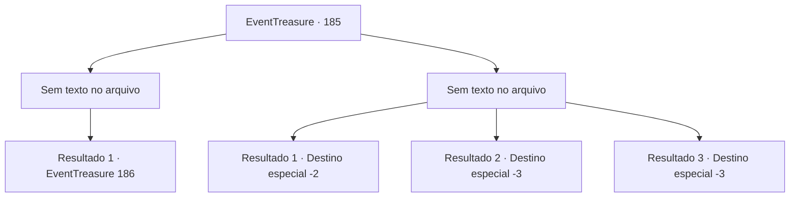

# Eventos de tesouro · 185

[Índice da tabela](index.md) · [Índice geral](../index.md)

ID: `pt:EventTreasure:185` · Fonte: `EventTreasure4` · Versão: 1.2.47.

Mapeamento estático dos arquivos; a disponibilidade e a execução dependem do estado da run.

## Texto do evento

*Sem texto no arquivo.*

## Dados de entrada

```json
{
  "id": 185,
  "grade": 1,
  "place": "",
  "required": ""
}
```

## Mapa das escolhas



## Escolhas e resultados

### Escolha 1

*Sem texto no arquivo; o papel dessa opção depende da interface do jogo.*

Requisitos e outros campos da escolha:

```json
{
  "required": ""
}
```

#### Resultado 1.1

Você derrota o monstro. Como se estivesse sem forças, ele volta à sua forma original. Em seguida, ele fica imóvel no chão. À medida que você se aproxima do cadáver, a esfera retorcida e em camadas de luz começa a se elevar.

Continuação registrada: [Evento 186](0186.md) na mesma tabela.

```json
{
  "required": "",
  "chance": "1",
  "nextEvent": 186,
  "type": 2,
  "reward": ""
}
```

### Escolha 2

*Sem texto no arquivo; o papel dessa opção depende da interface do jogo.*

Requisitos e outros campos da escolha:

```json
{
  "required": ""
}
```

#### Resultado 2.1

Depois de ser jogado ao chão, você pega um punhado de areia. Em seguida, joga nos olhos do monstro que se aproxima. 

 "Kyeek!"

 Ele recua cobrindo os olhos e você consegue escapar do monstro graças a isso.

Continuação registrada: [Destino especial `-2`](../destinos-especiais.md).

```json
{
  "required": "1_0_2|1_1_2",
  "chance": "1",
  "nextEvent": -2,
  "type": 2,
  "reward": "0_0_-1|0_1_-1|5_514_9"
}
```

#### Resultado 2.2

O monstro volta à sua forma original depois de te derrotar. Depois de envolver seu tentáculo crescido em sua mandíbula ao redor da sua cabeça, ele engole toda a sua cabeça com seu bico duro por baixo.

Continuação registrada: [Destino especial `-3`](../destinos-especiais.md).

```json
{
  "required": "2_0_2",
  "chance": "1",
  "nextEvent": -3,
  "type": 2,
  "reward": "0_0_-1|0_1_-1"
}
```

#### Resultado 2.3

O monstro volta à sua forma original depois de te derrotar. Depois de envolver seu tentáculo crescido em sua mandíbula ao redor da sua cabeça, ele engole toda a sua cabeça com seu bico duro por baixo.

Continuação registrada: [Destino especial `-3`](../destinos-especiais.md).

```json
{
  "required": "2_1_2",
  "chance": "1",
  "nextEvent": -3,
  "type": 2,
  "reward": "0_0_-1|0_1_-1"
}
```

## Referências que chegam a este evento

- [Evento 184 · escolha 1 · resultado 1](0184.md#escolha-1)
- [Evento 184 · escolha 1 · resultado 2](0184.md#escolha-1)
- [Evento 184 · escolha 1 · resultado 4](0184.md#escolha-1)
- [Evento 184 · escolha 2 · resultado 1](0184.md#escolha-2)
- [Evento 184 · escolha 2 · resultado 2](0184.md#escolha-2)
- [Evento 184 · escolha 3 · resultado 1](0184.md#escolha-3)
- [Evento 184 · escolha 3 · resultado 2](0184.md#escolha-3)
