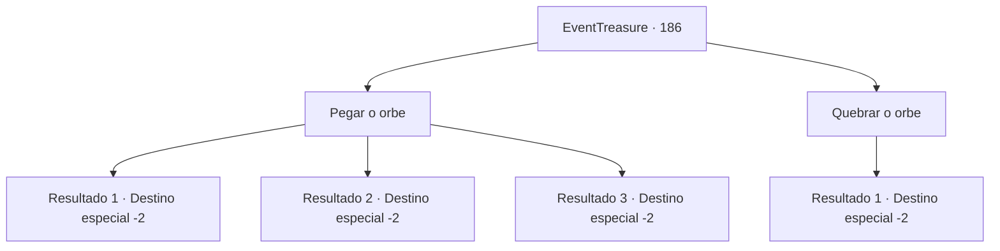

# Eventos de tesouro · 186

[Índice da tabela](index.md) · [Índice geral](../index.md)

ID: `pt:EventTreasure:186` · Fonte: `EventTreasure4` · Versão: 1.2.47.

Mapeamento estático dos arquivos; a disponibilidade e a execução dependem do estado da run.

## Texto do evento

*Sem texto no arquivo.*

## Dados de entrada

```json
{
  "id": 186,
  "grade": 1,
  "place": "",
  "required": ""
}
```

## Mapa das escolhas



## Escolhas e resultados

### Escolha 1

Pegar o orbe

Requisitos e outros campos da escolha:

```json
{
  "required": ""
}
```

#### Resultado 1.1

Você estende sua mão em direção à esfera de luz retorcida. Em seguida, a luz retorcida rasteja pela sua mão e se infiltra no seu braço. Após sentir um arrepio indescritivelmente estranho, você sente o poder recém-descoberto dentro de si. Quando você coloca força nos seus braços, eles se retorcem e tentáculos saem voando dele. Você retira o cadáver do monstro com o tentáculo e segue para o próximo destino.

Continuação registrada: [Destino especial `-2`](../destinos-especiais.md).

```json
{
  "required": "26_13_1",
  "chance": "1",
  "nextEvent": -2,
  "type": 2,
  "reward": "5_514_1|27_35_1|0_2_1"
}
```

#### Resultado 1.2

Você estende sua mão em direção à esfera de luz retorcida. Em seguida, a luz retorcida desaparece em sua mão. Enquanto isso, o pescador que havia fugido antes retorna com os guardas. E ele diz enquanto olha para a cabeça de polvo que você derrotou. 

 "O-Oh... Você derrotou...! Oh meu Deus... Obrigado!"

 Ele te dá algumas moedas de ouro como uma pequena recompensa. O guarda que veio com você faz algumas perguntas e vai embora com o pescador e o cadáver da cabeça do polvo.

Continuação registrada: [Destino especial `-2`](../destinos-especiais.md).

```json
{
  "required": "28_13_1|28_29_1|28_34_1",
  "chance": "1",
  "nextEvent": -2,
  "type": 2,
  "reward": "5_514_9|0_4_40|0_5_1"
}
```

#### Resultado 1.3

Você estende sua mão em direção à esfera de luz retorcida. Em seguida, a luz retorcida se desintegra. Enquanto isso, o pescador que havia fugido antes retorna com os guardas. E ele diz enquanto olha para a cabeça de polvo que você derrotou. 

 "O-Oh... Você derrotou...! Oh, meu Deus... Obrigado!"

 Ele te dá algumas moedas de ouro como uma pequena recompensa. O guarda que veio com você faz algumas perguntas e volta com o pescador e o cadáver da cabeça do polvo.

Continuação registrada: [Destino especial `-2`](../destinos-especiais.md).

```json
{
  "required": "-1|26_29_1|26_34_1",
  "chance": "1",
  "nextEvent": -2,
  "type": 2,
  "reward": "5_514_9|0_4_40"
}
```

### Escolha 2

Quebrar o orbe

Requisitos e outros campos da escolha:

```json
{
  "required": ""
}
```

#### Resultado 2.1

Atacas a esfera retorcida de luz e a quebras. Ela desaparece junto com o espaço distorcido. Enquanto isso, o pescador que havia fugido antes retorna com os guardas. E ele diz enquanto olha para a cabeça de polvo que você derrotou. 

 "O-Oh... Você a derrotou...! Oh, meu Deus... Obrigado!"

 Ele te dá algumas moedas de ouro como uma pequena recompensa. O guarda que veio com você faz algumas perguntas e volta com o pescador e o cadáver da cabeça de polvo.

Continuação registrada: [Destino especial `-2`](../destinos-especiais.md).

```json
{
  "required": "",
  "chance": "1",
  "nextEvent": -2,
  "type": 2,
  "reward": "5_514_9|0_4_40"
}
```

## Referências que chegam a este evento

- [Evento 185 · escolha 1 · resultado 1](0185.md#escolha-1)
