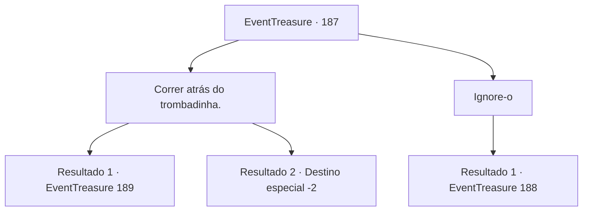

# Eventos de tesouro · 187

[Índice da tabela](index.md) · [Índice geral](../index.md)

ID: `pt:EventTreasure:187` · Fonte: `EventTreasure4` · Versão: 1.2.47.

Mapeamento estático dos arquivos; a disponibilidade e a execução dependem do estado da run.

## Texto do evento

Você visita a cidade portuária de ‘Lapas’ localizado na costa onde se pode ver um mar da cor de uma esmeralda. É uma bela cidade onde a luz do sol brilha intensamente em edifícios brancos com telhados verdes-azulados. Junto com o cheiro de peixe do oceano, e barcos ocupados saindo e entrando do porto, Você vê todos os tipos de produtos mercantes e peixes sendo descarregados. De repente, um homem negro esbarra em você e sai correndo. Uma mulher atrás de você grita: 

 "Um ladrão! Alguém, por favor pegue este ladrão de carteiras!!"


## Dados de entrada

```json
{
  "id": 187,
  "grade": 2,
  "place": "",
  "required": "1_4_30|5_515_0|26_1_1"
}
```

## Mapa das escolhas



## Escolhas e resultados

### Escolha 1

Correr atrás do trombadinha.

Requisitos e outros campos da escolha:

```json
{
  "required": ""
}
```

#### Resultado 1.1

Você persegue o batedor de carteiras. O batedor de carteiras não consegue escapar de você e acaba em um beco sem saída. Ele fala sem conseguir esconder o pânico em sua voz. 

 "Ofegante... Ofegante... Você é bem rápido. Vou te fazer... uma proposta. Você não poderia fechar os olhos para que eu possa ganhar a vida? Em troca, eu te mostrarei minha habilidade."


Continuação registrada: [Evento 189](0189.md) na mesma tabela.

```json
{
  "required": "",
  "chance": "1|0_6_1",
  "nextEvent": 189,
  "type": 0,
  "reward": "0_4_-50|5_515_1"
}
```

#### Resultado 1.2

Você persegue o batedor de carteiras. No entanto, ele se move pelos becos como se fosse sua casa e você acaba perdendo-o.

Continuação registrada: [Destino especial `-2`](../destinos-especiais.md).

```json
{
  "required": "",
  "chance": "16",
  "nextEvent": -2,
  "type": 1,
  "reward": "0_4_-50|5_515_9"
}
```

### Escolha 2

Ignore-o

Requisitos e outros campos da escolha:

```json
{
  "required": ""
}
```

#### Resultado 2.1

Ignoras o grito da mulher e tentas dirigir-te a uma taberna. Nesse momento, percebes que uma parte do teu dinheiro desapareceu. O carteirista que acabou de chocar contigo levou o teu ouro.

Continuação registrada: [Evento 188](0188.md) na mesma tabela.

```json
{
  "required": "",
  "chance": "1",
  "nextEvent": 188,
  "type": 2,
  "reward": "0_4_-50|5_515_1"
}
```

## Referências que chegam a este evento

Nenhum `nextEvent` positivo da mesma tabela aponta para este nó. Isso não prova que seja inacessível: sorteio e estado de história podem selecioná-lo.

