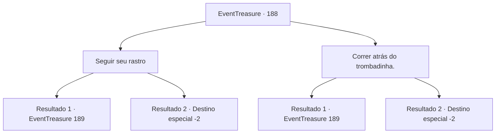

# Eventos de tesouro · 188

[Índice da tabela](index.md) · [Índice geral](../index.md)

ID: `pt:EventTreasure:188` · Fonte: `EventTreasure4` · Versão: 1.2.47.

Mapeamento estático dos arquivos; a disponibilidade e a execução dependem do estado da run.

## Texto do evento

*Sem texto no arquivo.*

## Dados de entrada

```json
{
  "id": 188,
  "grade": 1,
  "place": "",
  "required": ""
}
```

## Mapa das escolhas



## Escolhas e resultados

### Escolha 1

Seguir seu rastro

Requisitos e outros campos da escolha:

```json
{
  "required": ""
}
```

#### Resultado 1.1

Siga o rastro e descubra para onde o batedor de carteiras estava indo. Enquanto conta seus ganhos em um beco escuro, ele se assusta ao te ver. 

 "Ah-Ah! Espere. Espere! Você não poderia fingir que não viu para que eu possa ganhar a vida? Em troca, vou te mostrar minha habilidade."


Continuação registrada: [Evento 189](0189.md) na mesma tabela.

```json
{
  "required": "",
  "chance": "1|0_14_1",
  "nextEvent": 189,
  "type": 0,
  "reward": ""
}
```

#### Resultado 1.2

Tentas descobrir para onde o carteirista foi olhando as pistas, mas não consegues descobrir qual caminho ele tomou. No final, perdes o carteirista.

Continuação registrada: [Destino especial `-2`](../destinos-especiais.md).

```json
{
  "required": "",
  "chance": "14",
  "nextEvent": -2,
  "type": 1,
  "reward": "5_515_1"
}
```

### Escolha 2

Correr atrás do trombadinha.

Requisitos e outros campos da escolha:

```json
{
  "required": ""
}
```

#### Resultado 2.1

Você persegue o batedor de carteiras. O batedor de carteiras não consegue escapar de você e acaba em um beco sem saída. Ele fala sem conseguir esconder o pânico em sua voz. 

 "Ofegante... Ofegante... Você é bem rápido. Vou te fazer... uma proposta. Você não poderia fechar os olhos para que eu possa ganhar a vida? Em troca, eu te ensinarei minha habilidade."


Continuação registrada: [Evento 189](0189.md) na mesma tabela.

```json
{
  "required": "",
  "chance": "1|0_6_1",
  "nextEvent": 189,
  "type": 0,
  "reward": ""
}
```

#### Resultado 2.2

Você persegue o batedor de carteiras. No entanto, ele se move pelos becos como se fosse sua casa e você acaba perdendo-o.

Continuação registrada: [Destino especial `-2`](../destinos-especiais.md).

```json
{
  "required": "",
  "chance": "20",
  "nextEvent": -2,
  "type": 1,
  "reward": "5_515_1"
}
```

## Referências que chegam a este evento

- [Evento 187 · escolha 2 · resultado 1](0187.md#escolha-2)
