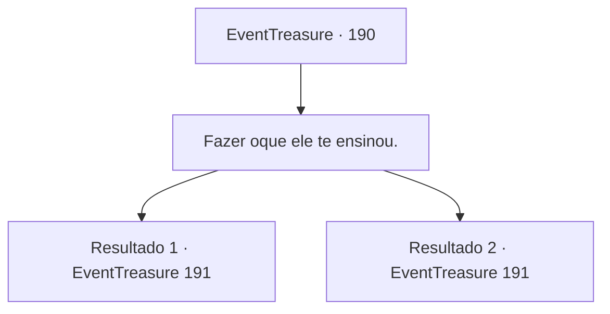

# Eventos de tesouro · 190

[Índice da tabela](index.md) · [Índice geral](../index.md)

ID: `pt:EventTreasure:190` · Fonte: `EventTreasure4` · Versão: 1.2.47.

Mapeamento estático dos arquivos; a disponibilidade e a execução dependem do estado da run.

## Texto do evento

*Sem texto no arquivo.*

## Dados de entrada

```json
{
  "id": 190,
  "grade": 1,
  "place": "",
  "required": ""
}
```

## Mapa das escolhas



## Escolhas e resultados

### Escolha 1

Fazer oque ele te ensinou.

Requisitos e outros campos da escolha:

```json
{
  "required": ""
}
```

#### Resultado 1.1

Copie as habilidades do batedor de carteiras como ele te ensinou. O batedor de carteiras te diz com um olhar surpreso. 

 "Não pensei que você aprenderia tão rápido. Você tem potencial! E-Então vou começar a agir."


Continuação registrada: [Evento 191](0191.md) na mesma tabela.

```json
{
  "required": "",
  "chance": "1|0_6_1|0_7_1",
  "nextEvent": 191,
  "type": 0,
  "reward": "27_21_1|0_2_1"
}
```

#### Resultado 1.2

Tentas copiar a habilidade que o batedor de carteiras te ensinou. No entanto, suas habilidades foram negligenciadas, para dizer o mínimo. 

 "Você deveria ser capaz de fazer isso bem com um pouco mais de prática. Ha. Haha."

 Você e o batedor de carteiras se encaram enquanto ele se afasta lentamente. 

 "E-Então eu vou embora."


Continuação registrada: [Evento 191](0191.md) na mesma tabela.

```json
{
  "required": "",
  "chance": "12",
  "nextEvent": 191,
  "type": 1,
  "reward": "5_515_9"
}
```

## Referências que chegam a este evento

- [Evento 189 · escolha 1 · resultado 1](0189.md#escolha-1)
