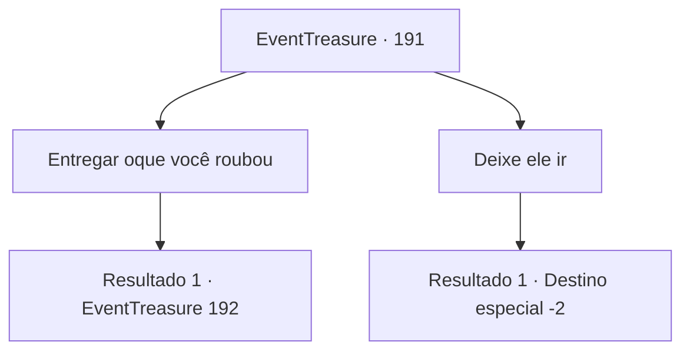

# Eventos de tesouro · 191

[Índice da tabela](index.md) · [Índice geral](../index.md)

ID: `pt:EventTreasure:191` · Fonte: `EventTreasure4` · Versão: 1.2.47.

Mapeamento estático dos arquivos; a disponibilidade e a execução dependem do estado da run.

## Texto do evento

*Sem texto no arquivo.*

## Dados de entrada

```json
{
  "id": 191,
  "grade": 1,
  "place": "",
  "required": ""
}
```

## Mapa das escolhas



## Escolhas e resultados

### Escolha 1

Entregar oque você roubou

Requisitos e outros campos da escolha:

```json
{
  "required": ""
}
```

#### Resultado 1.1

Você diz para ele devolver tudo o que havia roubado. No entanto, ele aperta a mandíbula e saca uma adaga. 

 "Maldição... Venha me pegar!"

 Parece que ele não vai entregar os bens roubados voluntariamente. Você decide usar a força contra ele.

Continuação registrada: [Evento 192](0192.md) na mesma tabela.

```json
{
  "required": "",
  "chance": "1",
  "nextEvent": 192,
  "type": 2,
  "reward": "6_0_2",
  "place": 4
}
```

### Escolha 2

Deixe ele ir

Requisitos e outros campos da escolha:

```json
{
  "required": ""
}
```

#### Resultado 2.1

Você deixa o batedor de carteiras escapar. Ele vai pelo beco dos fundos e desaparece entre a multidão.

Continuação registrada: [Destino especial `-2`](../destinos-especiais.md).

```json
{
  "required": "",
  "chance": "1",
  "nextEvent": -2,
  "type": 2,
  "reward": "5_515_9"
}
```

## Referências que chegam a este evento

- [Evento 190 · escolha 1 · resultado 1](0190.md#escolha-1)
- [Evento 190 · escolha 1 · resultado 2](0190.md#escolha-1)
