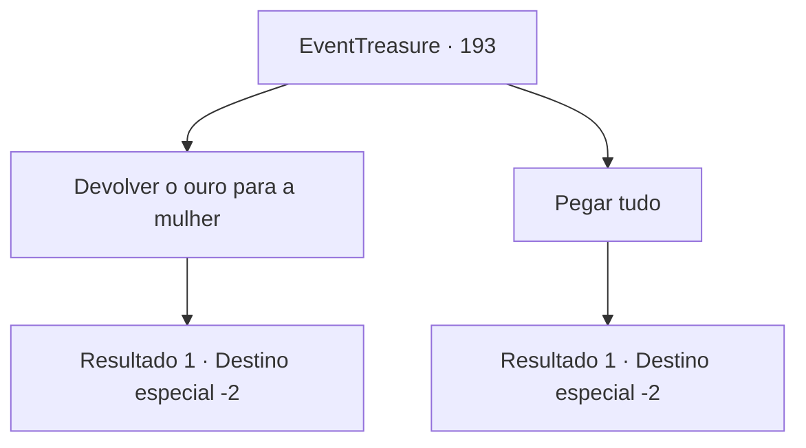

# Eventos de tesouro · 193

[Índice da tabela](index.md) · [Índice geral](../index.md)

ID: `pt:EventTreasure:193` · Fonte: `EventTreasure4` · Versão: 1.2.47.

Mapeamento estático dos arquivos; a disponibilidade e a execução dependem do estado da run.

## Texto do evento

*Sem texto no arquivo.*

## Dados de entrada

```json
{
  "id": 193,
  "grade": 1,
  "place": "",
  "required": ""
}
```

## Mapa das escolhas



## Escolhas e resultados

### Escolha 1

Devolver o ouro para a mulher

Requisitos e outros campos da escolha:

```json
{
  "required": ""
}
```

#### Resultado 1.1

Para encontrar a mulher que você conheceu antes, você volta ao lugar onde tudo começou. A mulher te nota e se aproxima de você com um sorriso aliviado. 

 "Você pegou o ladrão?"

 Você assente com a cabeça e devolve o ouro que parece ter sido roubado dela. Então ela se curva várias vezes para expressar sua gratidão. 

 "Obrigada! Muito obrigada!"

 Depois ela guarda o ouro e se afasta apressadamente.

Continuação registrada: [Destino especial `-2`](../destinos-especiais.md).

```json
{
  "required": "",
  "chance": "1",
  "nextEvent": -2,
  "type": 2,
  "reward": "0_4_-90|0_3_2|5_515_9|0_2_1"
}
```

### Escolha 2

Pegar tudo

Requisitos e outros campos da escolha:

```json
{
  "required": ""
}
```

#### Resultado 2.1

Leve todo o ouro que você obteve do batedor de carteiras. Além disso, você se move na direção oposta à grande rua onde a mulher estava para evitar encontrá-la.

Continuação registrada: [Destino especial `-2`](../destinos-especiais.md).

```json
{
  "required": "",
  "chance": "1",
  "nextEvent": -2,
  "type": 2,
  "reward": "0_3_-2|5_515_9"
}
```

## Referências que chegam a este evento

- [Evento 192 · escolha 1 · resultado 1](0192.md#escolha-1)
