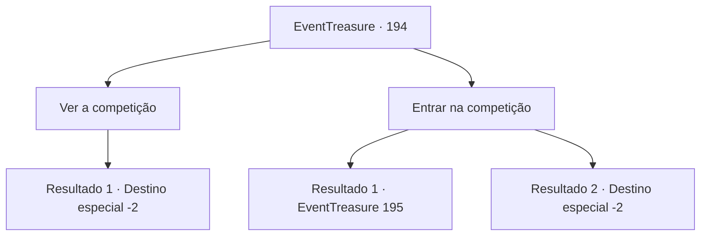

# Eventos de tesouro · 194

[Índice da tabela](index.md) · [Índice geral](../index.md)

ID: `pt:EventTreasure:194` · Fonte: `EventTreasure4` · Versão: 1.2.47.

Mapeamento estático dos arquivos; a disponibilidade e a execução dependem do estado da run.

## Texto do evento

Você viaja para uma cidade chamada ‘Parta’ no topo de uma montanha rochosa. O lugar é famoso por treinar bravos guerreiros atráves de um processo vicioso. Os guerreiros musculosos fazem jus á esta reputação, competindo entre si na praça da cidade E tem um homem, que se parece com um recepcionista, perto deles.

## Dados de entrada

```json
{
  "id": 194,
  "grade": 2,
  "place": "",
  "required": "1_2_50|5_516_0|26_2_1"
}
```

## Mapa das escolhas



## Escolhas e resultados

### Escolha 1

Ver a competição

Requisitos e outros campos da escolha:

```json
{
  "required": ""
}
```

#### Resultado 1.1

Você começa a vê-los competindo entre si. Os guerreiros competem lançando lanças, lutando e levantando grandes pedras. Eles competem durante todo o dia e é concedida uma coroa feita de folhas de louro e um troféu dourado ao vencedor final. As pessoas da vila aplaudem para celebrar o vencedor e você sai da praça depois de vê-lo.

Continuação registrada: [Destino especial `-2`](../destinos-especiais.md).

```json
{
  "required": "",
  "chance": "1",
  "nextEvent": -2,
  "type": 2,
  "reward": "5_516_9"
}
```

### Escolha 2

Entrar na competição

Requisitos e outros campos da escolha:

```json
{
  "required": ""
}
```

#### Resultado 2.1

Você diz que também quer competir. A pessoa que está registrando os pontos e está ao seu lado se aproxima e mostra um pergaminho. 

 "Agora. Leia o que está escrito e assine se quiser participar."

 Você começa a ler o pergaminho. A competição consiste em lançamento de lanças, luta e levantamento de pedras. Também há uma cláusula que estabelece que se você se machucar, não desafiará os organizadores nem o oponente.

Continuação registrada: [Evento 195](0195.md) na mesma tabela.

```json
{
  "required": "20_60_1",
  "chance": "1",
  "nextEvent": 195,
  "type": 2,
  "reward": "5_516_1"
}
```

#### Resultado 2.2

Você diz a ele que também quer competir. No entanto, a pessoa ao seu lado, que está marcando os pontos, olha para você de cima a baixo e balança a cabeça. 

 "Receio que não. Você parece muito fraco para se juntar."

 Ele rejeita sua entrada e no final você decide apenas assistir ao jogo em que estão participando. Os guerreiros competem lançando lanças, lutando e levantando grandes pedras. Eles competem durante todo o dia e é concedida uma coroa feita de folhas de louro e um troféu de ouro ao vencedor final. As pessoas da vila aplaudem para celebrar o vencedor e você sai da praça depois de vê-lo.

Continuação registrada: [Destino especial `-2`](../destinos-especiais.md).

```json
{
  "required": "21_60_1",
  "chance": "1",
  "nextEvent": -2,
  "type": 2,
  "reward": "5_516_9"
}
```

## Referências que chegam a este evento

Nenhum `nextEvent` positivo da mesma tabela aponta para este nó. Isso não prova que seja inacessível: sorteio e estado de história podem selecioná-lo.

