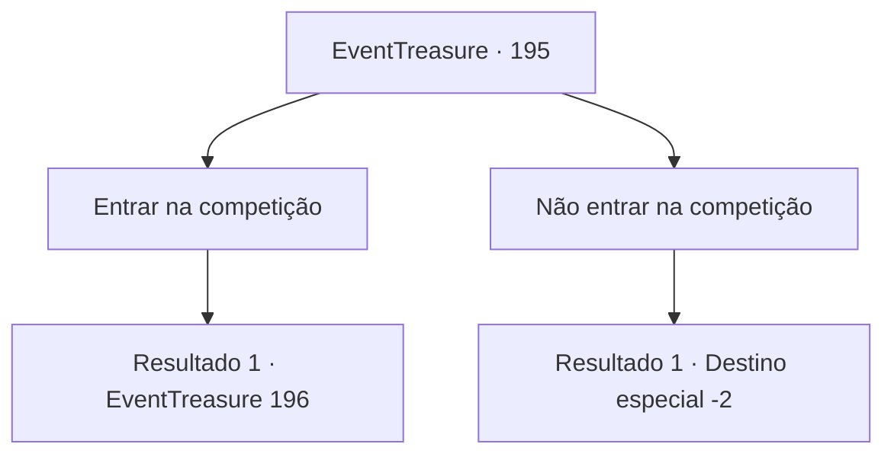

# Eventos de tesouro · 195

[Índice da tabela](index.md) · [Índice geral](../index.md)

ID: `pt:EventTreasure:195` · Fonte: `EventTreasure4` · Versão: 1.2.47.

Mapeamento estático dos arquivos; a disponibilidade e a execução dependem do estado da run.

## Texto do evento

*Sem texto no arquivo.*

## Dados de entrada

```json
{
  "id": 195,
  "grade": 1,
  "place": "",
  "required": ""
}
```

## Mapa das escolhas



## Escolhas e resultados

### Escolha 1

Entrar na competição

Requisitos e outros campos da escolha:

```json
{
  "required": ""
}
```

#### Resultado 1.1

Você assina o pergaminho e decide se juntar à competição. 

 "Ótimo. Então, por favor, vá para a sala de espera. Eu te chamarei quando for a sua vez."

 O recepcionista te leva para a sala onde os competidores estão esperando. Na sala de espera, os guerreiros musculosos tentam relaxar à sua maneira, rezando, se esticando ou meditando de olhos fechados. Não muito tempo depois, o recepcionista entra na sala e chama você e a pessoa com quem você competirá. 

 "Agora. {1}. E Lan. Saiam."

 Você está competindo em lançamento de lanças com alguém chamado Lan. Os braços e ombros fortes de Lan são impressionantes. 

 "Uf..."

 Ele passa resina de pinho em suas mãos e pega a lança feita de madeira. Então ele a lança o mais forte que pode. A lança corta o vento, voa cerca de 200 pés e fica cravada no chão. O público começa a aplaudir seu impressionante recorde. Lan encolhe os ombros e te olha com um sorriso frio.

Continuação registrada: [Evento 196](0196.md) na mesma tabela.

```json
{
  "required": "",
  "chance": "1",
  "nextEvent": 196,
  "type": 2,
  "reward": "5_516_1"
}
```

### Escolha 2

Não entrar na competição

Requisitos e outros campos da escolha:

```json
{
  "required": ""
}
```

#### Resultado 2.1

Não assine o pergaminho. E você decide apenas observar outras pessoas competindo. Os guerreiros competem lançando lanças, lutando e levantando grandes pedras. Eles competem durante todo o dia, e é concedida uma coroa feita de folhas de louro e um troféu de ouro ao vencedor final. As pessoas da vila aplaudem para celebrar o vencedor, e você sai da praça depois de observar.

Continuação registrada: [Destino especial `-2`](../destinos-especiais.md).

```json
{
  "required": "",
  "chance": "1",
  "nextEvent": -2,
  "type": 2,
  "reward": "5_516_9"
}
```

## Referências que chegam a este evento

- [Evento 194 · escolha 2 · resultado 1](0194.md#escolha-2)
