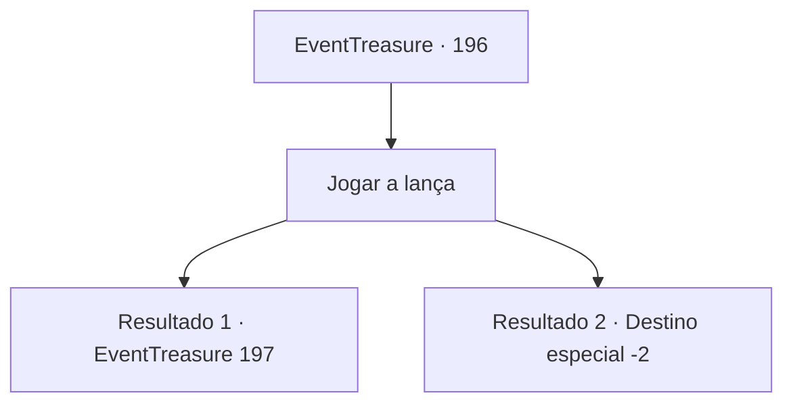

# Eventos de tesouro · 196

[Índice da tabela](index.md) · [Índice geral](../index.md)

ID: `pt:EventTreasure:196` · Fonte: `EventTreasure4` · Versão: 1.2.47.

Mapeamento estático dos arquivos; a disponibilidade e a execução dependem do estado da run.

## Texto do evento

*Sem texto no arquivo.*

## Dados de entrada

```json
{
  "id": 196,
  "grade": 1,
  "place": "",
  "required": ""
}
```

## Mapa das escolhas



## Escolhas e resultados

### Escolha 1

Jogar a lança

Requisitos e outros campos da escolha:

```json
{
  "required": ""
}
```

#### Resultado 1.1

Também pegas resina de pinheiro na mão e apanhas uma lança. Depois lanças-a o mais forte que conseguires. A lança corta o vento com uma força temível. Depois a lança aterra mais longe do que a lança de Lan tinha aterrado. 

 "Vencedor. {1}!"

 Passas ao lado do desapontado Lan e voltas para a sala de espera. Os confrontos dos outros competidores avançam e chamam o teu nome novamente algumas horas depois. Desta vez vais lutar contra o teu oponente. O teu oponente, que é uma pessoa grande com uma constituição geralmente robusta, diz-te com um olhar confiante. 

 "Prazer em conhecer-te. Sou 'Radeluce'. Pareces assustado, mas não te preocupes demasiado, miúdo. Vai acabar num instante. Ahahaha!"


Continuação registrada: [Evento 197](0197.md) na mesma tabela.

```json
{
  "required": "",
  "chance": "1|0_5_1",
  "nextEvent": 197,
  "type": 0,
  "reward": ""
}
```

#### Resultado 1.2

Também você coloca resina de pinho na mão e pega uma lança. Então você a lança o mais forte que pode. A lança corta o vento, mas fica aquém da lança que Lan lançou. 

 "Vencedor. Lan!"

 Lan sorri orgulhoso, e você é desqualificado/a da competição.

Continuação registrada: [Destino especial `-2`](../destinos-especiais.md).

```json
{
  "required": "",
  "chance": "14",
  "nextEvent": -2,
  "type": 1,
  "reward": "5_516_9"
}
```

## Referências que chegam a este evento

- [Evento 195 · escolha 1 · resultado 1](0195.md#escolha-1)
