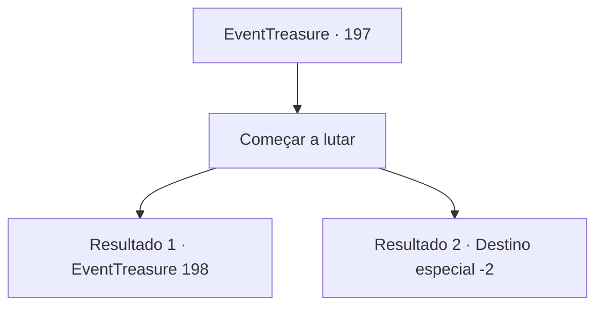

# Eventos de tesouro · 197

[Índice da tabela](index.md) · [Índice geral](../index.md)

ID: `pt:EventTreasure:197` · Fonte: `EventTreasure4` · Versão: 1.2.47.

Mapeamento estático dos arquivos; a disponibilidade e a execução dependem do estado da run.

## Texto do evento

*Sem texto no arquivo.*

## Dados de entrada

```json
{
  "id": 197,
  "grade": 1,
  "place": "",
  "required": ""
}
```

## Mapa das escolhas



## Escolhas e resultados

### Escolha 1

Começar a lutar

Requisitos e outros campos da escolha:

```json
{
  "required": ""
}
```

#### Resultado 1.1

Radeluce corre em sua direção com uma velocidade descomunal em relação ao seu grande tamanho. No entanto, você se mantém firme sem recuar. Depois de trocarem movimentos por um tempo, você percebe que ele está ficando cansado e o agarra por trás. Então você o nocauteia instantaneamente estrangulando seu pescoço. 

 "Radeluce caiu! Vencedor {1}!"

 O público comemora sua vitória aplaudindo ou assobiando. Radeluce é levado em uma maca de emergência, e você volta a esperar e descansar. 

 Depois de mais algumas rodadas, é sua vez novamente. Desta vez, a competição é 'levantar pedras', onde você tem que levantar três pedras grandes e colocar cada uma delas em cima de um pilar. Sua oponente é uma mulher chamada 'Razu', Ela é meio gigante que é mais alta que você por duas cabeças e maior em tamanho. Razu diz enquanto aplica resina de pinho em suas mãos. 

 " Que vença a melhor pessoa."

 Assim que ela termina de falar, a partida começa.  

 "Agora. Esta é a última partida do dia. Quem será o vencedor desta competição? Prepare-se... Comece!"


Continuação registrada: [Evento 198](0198.md) na mesma tabela.

```json
{
  "required": "",
  "chance": "1|0_5_1",
  "nextEvent": 198,
  "type": 0,
  "reward": ""
}
```

#### Resultado 1.2

Radeluce se lança em sua direção com uma velocidade que não condiz com seu tamanho imenso. Em seguida, instantaneamente te vira de cabeça para baixo. Depois de ser jogado no chão, você não consegue se mover com Radeluce em cima de você. 

 "Vencedor. Radeluce!"

 Quando o resultado da luta é anunciado, Radeluce sorri ainda mais triunfante. E ele te levanta e diz. 

 "Considere-se sortudo. Ter-me como oponente. Hahaha!"

 Ele bate em seus ombros e volta para a sala de espera. Depois de perder a luta, você deixa a praça.

Continuação registrada: [Destino especial `-2`](../destinos-especiais.md).

```json
{
  "required": "",
  "chance": "18",
  "nextEvent": -2,
  "type": 1,
  "reward": "5_516_9"
}
```

## Referências que chegam a este evento

- [Evento 196 · escolha 1 · resultado 1](0196.md#escolha-1)
