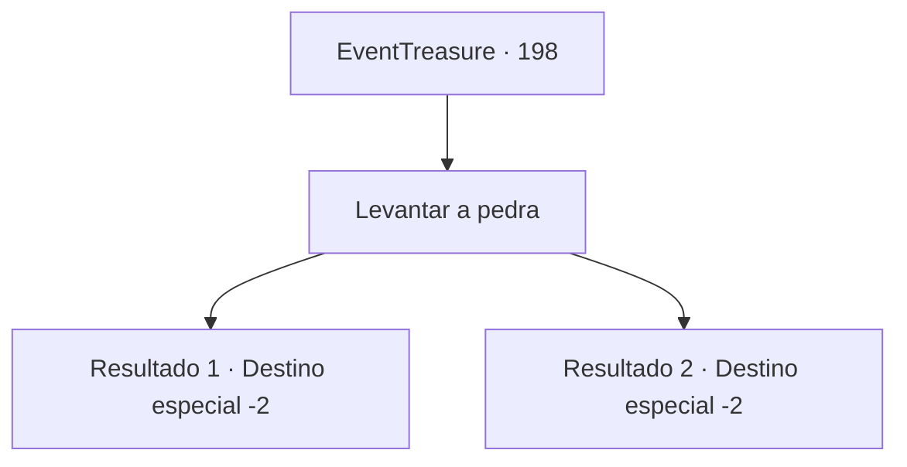

# Eventos de tesouro · 198

[Índice da tabela](index.md) · [Índice geral](../index.md)

ID: `pt:EventTreasure:198` · Fonte: `EventTreasure4` · Versão: 1.2.47.

Mapeamento estático dos arquivos; a disponibilidade e a execução dependem do estado da run.

## Texto do evento

*Sem texto no arquivo.*

## Dados de entrada

```json
{
  "id": 198,
  "grade": 1,
  "place": "",
  "required": ""
}
```

## Mapa das escolhas



## Escolhas e resultados

### Escolha 1

Levantar a pedra

Requisitos e outros campos da escolha:

```json
{
  "required": ""
}
```

#### Resultado 1.1

Você levanta a grande rocha com cada grama de força que tem em seu corpo. E a coloca no topo do primeiro pilar. A rocha parece pesar pelo menos algumas centenas de quilogramas. Mesmo assim, você não desiste e levanta a rocha com uma força sobre-humana. Quando coloca a segunda e terceira rocha em cada um dos pilares, a plateia aplaude e comemora por você. <link=shake>

 "Uau!"

</link> Você acaba sendo apenas um pouco mais rápido que Razu. 

 "O vencedor de hoje! {1}!!"

 Quando você é anunciado como o vencedor, os outros competidores e a plateia aplaudem e comemoram por você. Em seguida, o apresentador se aproxima de você e coloca a coroa feita de folhas de louro em sua cabeça. 

 "Aqui, pegue isso. Este é o prêmio do vencedor."

 Ele te elogia chamando você de verdadeiramente a 'pessoa mais forte' e te entrega o dinheiro do prêmio. Você pega a bolsa bastante pesada e sai da cidade com as pessoas te parabenizando.

Continuação registrada: [Destino especial `-2`](../destinos-especiais.md).

```json
{
  "required": "",
  "chance": "1|0_5_1",
  "nextEvent": -2,
  "type": 0,
  "reward": "0_4_100|27_22_1|5_516_9|0_2_1"
}
```

#### Resultado 1.2

Você levanta a grande rocha com cada grama de força que tem em seu corpo. E a coloca em cima do primeiro pilar. A rocha parece pesar pelo menos algumas centenas de quilogramas. Depois de levantar apenas uma única rocha, você fica sem forças e não consegue levantar outra. 

 "O vencedor de hoje! Razu!"

 Finalmente, Razu, o vencedor da partida, se retira, e Razu também recebe o prêmio vencedor junto com fortes aplausos do público. Depois de perder a partida, você abandona a praça.

Continuação registrada: [Destino especial `-2`](../destinos-especiais.md).

```json
{
  "required": "",
  "chance": "18",
  "nextEvent": -2,
  "type": 1,
  "reward": "5_516_9"
}
```

## Referências que chegam a este evento

- [Evento 197 · escolha 1 · resultado 1](0197.md#escolha-1)
