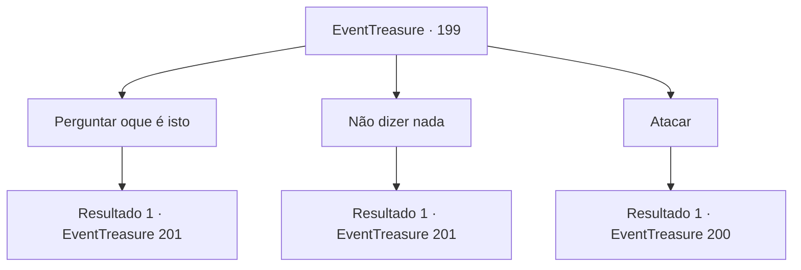

# Eventos de tesouro · 199

[Índice da tabela](index.md) · [Índice geral](../index.md)

ID: `pt:EventTreasure:199` · Fonte: `EventTreasure4` · Versão: 1.2.47.

Mapeamento estático dos arquivos; a disponibilidade e a execução dependem do estado da run.

## Texto do evento

O sol se põe na montanha à oeste, e a escuridão toma conta. Você decide acampar sobre uma colina com um penhasco rochoso atrás, e uma vista para uma pequena vila a frente. Quando você esta abrindo a sua tenda, alguém te chamar mais acima na colina. 

 "Ei! {1}. Eu quero falar com você."


## Dados de entrada

```json
{
  "id": 199,
  "grade": 2,
  "place": "",
  "required": "26_3_1|1_2_50|5_571_0"
}
```

## Mapa das escolhas



## Escolhas e resultados

### Escolha 1

Perguntar oque é isto

Requisitos e outros campos da escolha:

```json
{
  "required": ""
}
```

#### Resultado 1.1

Com a sua pergunta, a pessoa tira um pedaço de pergaminho. 

 "Eu sou um mensageiro da 'Arena Dourada', uma das seitas dos Hassassin. A sua fama chegou ao nosso líder, e ele tem uma mensagem para você."

 No pergaminho que ele te deu, ele pede que você se infiltre em 'Turga', o bastião da Rocha Vermelha, e mate o seu líder 'Karadeniz'.

Continuação registrada: [Evento 201](0201.md) na mesma tabela.

```json
{
  "required": "",
  "chance": "1",
  "nextEvent": 201,
  "type": 2,
  "reward": ""
}
```

### Escolha 2

Não dizer nada

Requisitos e outros campos da escolha:

```json
{
  "required": ""
}
```

#### Resultado 2.1

Você diz que não tem nada a dizer. No entanto, ele se aproxima de você e entrega um pedaço de pergaminho. 

 "Eu sou um mensageiro da Arena Dourada. Sua fama chegou ao nosso líder e ele tem uma mensagem para você."

 No pergaminho que ele te entregou, ele pede que você se infiltre em 'Turga', o bastião da Rocha Vermelha, e mate seu líder 'Karadeniz'.

Continuação registrada: [Evento 201](0201.md) na mesma tabela.

```json
{
  "required": "",
  "chance": "1",
  "nextEvent": 201,
  "type": 2,
  "reward": ""
}
```

### Escolha 3

Atacar

Requisitos e outros campos da escolha:

```json
{
  "required": ""
}
```

#### Resultado 3.1

Atacas o desconhecido que se aproximava, e ele rapidamente saca uma adaga.

Continuação registrada: [Evento 200](0200.md) na mesma tabela.

```json
{
  "required": "",
  "chance": "1",
  "nextEvent": 200,
  "type": 2,
  "reward": "6_0_48",
  "place": 0
}
```

## Referências que chegam a este evento

Nenhum `nextEvent` positivo da mesma tabela aponta para este nó. Isso não prova que seja inacessível: sorteio e estado de história podem selecioná-lo.

