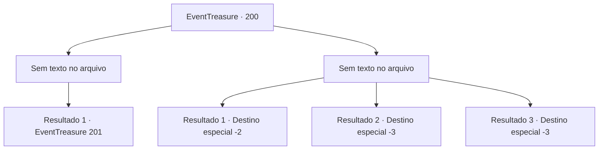

# Eventos de tesouro · 200

[Índice da tabela](index.md) · [Índice geral](../index.md)

ID: `pt:EventTreasure:200` · Fonte: `EventTreasure4` · Versão: 1.2.47.

Mapeamento estático dos arquivos; a disponibilidade e a execução dependem do estado da run.

## Texto do evento

*Sem texto no arquivo.*

## Dados de entrada

```json
{
  "id": 200,
  "grade": 1,
  "place": "",
  "required": ""
}
```

## Mapa das escolhas



## Escolhas e resultados

### Escolha 1

*Sem texto no arquivo; o papel dessa opção depende da interface do jogo.*

Requisitos e outros campos da escolha:

```json
{
  "required": ""
}
```

#### Resultado 1.1

Você derruba o desconhecido e se aproxima dele. Então ele estende as mãos e grita urgentemente. 

 "Espera...! Vou embora depois de te dar isso!"

 Você repete várias vezes que não tem intenção de atacar e lentamente coloca a mão no bolso interno. Em seguida, ele tira um pedaço de pergaminho e joga aos seus pés. No pergaminho, você é solicitado a se infiltrar em 'Turga', o bastião da Roca Vermelha, e matar seu líder 'Karadeniz'.

Continuação registrada: [Evento 201](0201.md) na mesma tabela.

```json
{
  "required": "",
  "chance": "1",
  "nextEvent": 201,
  "type": 2,
  "reward": ""
}
```

### Escolha 2

*Sem texto no arquivo; o papel dessa opção depende da interface do jogo.*

Requisitos e outros campos da escolha:

```json
{
  "required": ""
}
```

#### Resultado 2.1

Você foi derrotado pelo desconhecido. Ele guarda sua adaga e diz enquanto estala a língua. 

 "Tch... Você não é tão habilidoso como eu pensava. Talvez fosse apenas um rumor."

 Em seguida, ele desaparece sobre a colina.

Continuação registrada: [Destino especial `-2`](../destinos-especiais.md).

```json
{
  "required": "1_0_2|1_1_2",
  "chance": "1",
  "nextEvent": -2,
  "type": 2,
  "reward": "5_571_9|0_0_-1|0_1_-1"
}
```

#### Resultado 2.2

A adaga do desconhecido atravessa o seu lado. Ele estala a língua e murmura. 

 "Tch... Não planejava matá-lo."

 Em seguida, ele desaparece pela colina, deixando você no chão sangrando. Seu corpo começa a esfriar e eventualmente você desmaia.

Continuação registrada: [Destino especial `-3`](../destinos-especiais.md).

```json
{
  "required": "2_0_2",
  "chance": "1",
  "nextEvent": -3,
  "type": 2,
  "reward": "0_0_-1|0_1_-1"
}
```

#### Resultado 2.3

A adaga do desconhecido atravessa o seu lado. Ele estala a língua e murmura. 

 "Tch... Não planejava matá-lo."

 Em seguida, ele desaparece pela colina, deixando você no chão sangrando. Seu corpo começa a esfriar e eventualmente você desmaia.

Continuação registrada: [Destino especial `-3`](../destinos-especiais.md).

```json
{
  "required": "2_1_2",
  "chance": "1",
  "nextEvent": -3,
  "type": 2,
  "reward": "0_0_-1|0_1_-1"
}
```

## Referências que chegam a este evento

- [Evento 199 · escolha 3 · resultado 1](0199.md#escolha-3)
