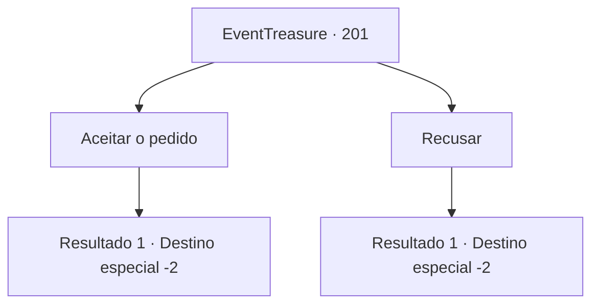

# Eventos de tesouro · 201

[Índice da tabela](index.md) · [Índice geral](../index.md)

ID: `pt:EventTreasure:201` · Fonte: `EventTreasure4` · Versão: 1.2.47.

Mapeamento estático dos arquivos; a disponibilidade e a execução dependem do estado da run.

## Texto do evento

*Sem texto no arquivo.*

## Dados de entrada

```json
{
  "id": 201,
  "grade": 1,
  "place": "",
  "required": ""
}
```

## Mapa das escolhas



## Escolhas e resultados

### Escolha 1

Aceitar o pedido

Requisitos e outros campos da escolha:

```json
{
  "required": ""
}
```

#### Resultado 1.1

Decido aceitar o pedido. O mensageiro da Arena Dourada diz com um sorriso satisfeito. 

 "Ótimo. Então, estarei te esperando na pousada chamada 'Esturões de Prata Pura' em Turga."

 Ele te entrega algumas moedas de ouro dizendo que é um depósito pelo pedido e desaparece pela colina.

Continuação registrada: [Destino especial `-2`](../destinos-especiais.md).

```json
{
  "required": "",
  "chance": "1",
  "nextEvent": -2,
  "type": 2,
  "reward": "0_4_20|5_571_1"
}
```

### Escolha 2

Recusar

Requisitos e outros campos da escolha:

```json
{
  "required": ""
}
```

#### Resultado 2.1

Você rejeita o pedido dele. Ele lambe os lábios com decepção. 

 "Suponho que não pode ser evitado. Adeus."

 Depois de dizer adeus, ele desaparece sobre a colina.

Continuação registrada: [Destino especial `-2`](../destinos-especiais.md).

```json
{
  "required": "",
  "chance": "1",
  "nextEvent": -2,
  "type": 2,
  "reward": "5_571_9"
}
```

## Referências que chegam a este evento

- [Evento 199 · escolha 1 · resultado 1](0199.md#escolha-1)
- [Evento 199 · escolha 2 · resultado 1](0199.md#escolha-2)
- [Evento 200 · escolha 1 · resultado 1](0200.md#escolha-1)
