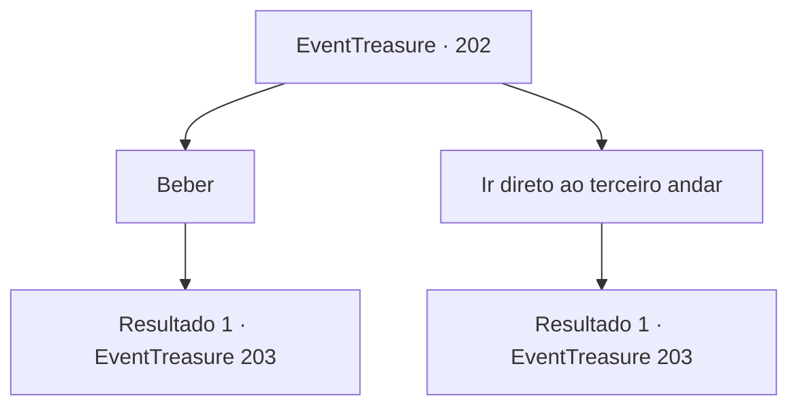

# Eventos de tesouro · 202

[Índice da tabela](index.md) · [Índice geral](../index.md)

ID: `pt:EventTreasure:202` · Fonte: `EventTreasure4` · Versão: 1.2.47.

Mapeamento estático dos arquivos; a disponibilidade e a execução dependem do estado da run.

## Texto do evento

|drawing_desertForest| Você viaja até uma cidade chamada ‘Turga’ onde a fortaleza Pedra Vermelha é localizada. Em Turga, que está no deserto com ventos secos e quentes, tem um forte no meio da cidade construido ao londo das montanhas rochosas. Assim como você foi instruído pelo mensageiro que conheceu da última vez, você vai para a taverna ‘Esturjão Cinza’ localizado nos arredores da cidade. Quando você entra pela porta de madeira que range, o proprietário lhe entrega um copo de cerveja e conta. 

 "Há alguém esperando por você no terceiro andar."


## Dados de entrada

```json
{
  "id": 202,
  "grade": 2,
  "place": "",
  "required": "5_571_1"
}
```

## Mapa das escolhas



## Escolhas e resultados

### Escolha 1

Beber

Requisitos e outros campos da escolha:

```json
{
  "required": "1_4_5"
}
```

#### Resultado 1.1

Você bebe o copo gelado de cerveja depois de pagar um pouco de ouro. Então você sobe para o terceiro andar da pousada. Quando você chega ao terceiro andar, um homem apoiado na parede do corredor te vê e te cumprimenta com a mão. É o mensageiro de The Golden Sand que você conheceu da última vez. 

 "Eu estive te esperando. {1}. Siga-me por aqui."

 Ele te guia para um quarto. Há outros Hassassins lá dentro. Também há uma cadeira e uma mesa antigas, e sobre a mesa há um mapa estendido. 

 "Estávamos planejando algo. Por favor, dê uma olhada neste mapa."


Continuação registrada: [Evento 203](0203.md) na mesma tabela.

```json
{
  "required": "",
  "chance": "1",
  "nextEvent": 203,
  "type": 2,
  "reward": "0_1_1|0_4_-5|5_571_2"
}
```

### Escolha 2

Ir direto ao terceiro andar

Requisitos e outros campos da escolha:

```json
{
  "required": ""
}
```

#### Resultado 2.1

Você sobe diretamente para o terceiro andar da pousada. Quando você chega ao terceiro andar, um homem apoiado na parede do corredor te vê e te cumprimenta com a mão. É o mensageiro de The Golden Sand que você conheceu da última vez. 

 "Eu estive esperando por você. {1}. Siga-me por aqui."

 Ele te guia para um quarto. Há outros Hassassins lá dentro. Também há uma cadeira e uma mesa antigas, e sobre a mesa há um mapa estendido. 

 "Estávamos planejando algo. Por favor, dê uma olhada neste mapa."


Continuação registrada: [Evento 203](0203.md) na mesma tabela.

```json
{
  "required": "",
  "chance": "1",
  "nextEvent": 203,
  "type": 2,
  "reward": "5_571_2"
}
```

## Referências que chegam a este evento

Nenhum `nextEvent` positivo da mesma tabela aponta para este nó. Isso não prova que seja inacessível: sorteio e estado de história podem selecioná-lo.

