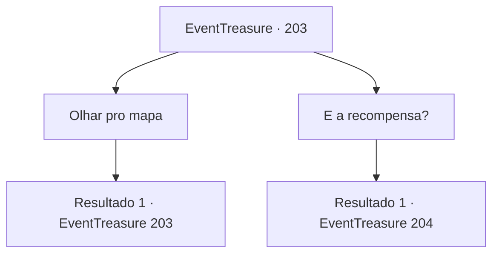

# Eventos de tesouro · 203

[Índice da tabela](index.md) · [Índice geral](../index.md)

ID: `pt:EventTreasure:203` · Fonte: `EventTreasure4` · Versão: 1.2.47.

Mapeamento estático dos arquivos; a disponibilidade e a execução dependem do estado da run.

## Texto do evento

*Sem texto no arquivo.*

## Dados de entrada

```json
{
  "id": 203,
  "grade": 1,
  "place": "",
  "required": ""
}
```

## Mapa das escolhas



## Escolhas e resultados

### Escolha 1

Olhar pro mapa

Requisitos e outros campos da escolha:

```json
{
  "required": "5_572_0"
}
```

#### Resultado 1.1

Olhas o mapa em cima da mesa. O mapa tem o plano da fortaleza desenhado nele. 

 "O verdadeiro governante deste castelo, Karadeniz, líder das Rochas Vermelhas, é conhecido por seu luxo e indulgência, sua tributação e punição implacáveis. Além disso... Há até rumores de que ele come carne humana. Muitas pessoas estão insatisfeitas por causa disso. Você deve entrar pelos esgotos como mostrado aqui enquanto nós causamos um escândalo com os cidadãos."

 Dá um gole de água e continua. 

 "Os esgotos estão conectados a um passagem secreta que está ligada à adega de vinhos. E a adega de vinhos está conectada à cozinha. Agora, aqui..."

 Move o dedo sobre o mapa e teus olhos seguem seu dedo. 

 "Aqui. Este é o quarto dele. Há uma passagem na cozinha que está conectada ao quarto dele. Você deve ser capaz de subir aqui. Mate Karadeniz. Então sua missão estará completa.

Continuação registrada: [Evento 203](0203.md) na mesma tabela.

```json
{
  "required": "",
  "chance": "1",
  "nextEvent": 203,
  "type": 2,
  "reward": "5_572_1"
}
```

### Escolha 2

E a recompensa?

Requisitos e outros campos da escolha:

```json
{
  "required": "5_572_1"
}
```

#### Resultado 2.1

Pergunta qual é a recompensa pela solicitação. Em seguida, o mensageiro aponta para o mapa novamente. 

 "Aqui. Supomos que este quarto seja sua sala-cofre pessoal. Você pode pegar tudo o que estiver lá."


Continuação registrada: [Evento 204](0204.md) na mesma tabela.

```json
{
  "required": "",
  "chance": "1",
  "nextEvent": 204,
  "type": 2,
  "reward": ""
}
```

## Referências que chegam a este evento

- [Evento 202 · escolha 1 · resultado 1](0202.md#escolha-1)
- [Evento 202 · escolha 2 · resultado 1](0202.md#escolha-2)
- [Evento 203 · escolha 1 · resultado 1](0203.md#escolha-1)
