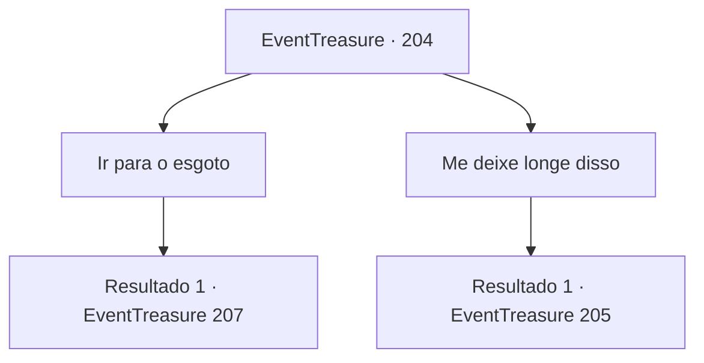

# Eventos de tesouro · 204

[Índice da tabela](index.md) · [Índice geral](../index.md)

ID: `pt:EventTreasure:204` · Fonte: `EventTreasure4` · Versão: 1.2.47.

Mapeamento estático dos arquivos; a disponibilidade e a execução dependem do estado da run.

## Texto do evento

*Sem texto no arquivo.*

## Dados de entrada

```json
{
  "id": 204,
  "grade": 1,
  "place": "",
  "required": ""
}
```

## Mapa das escolhas



## Escolhas e resultados

### Escolha 1

Ir para o esgoto

Requisitos e outros campos da escolha:

```json
{
  "required": ""
}
```

#### Resultado 1.1

Os membros da Arena Dourada dirigem-se à praça onde os cidadãos se reúnem, e você decide se infiltrar na fortaleza através do esgoto. Além do cheiro desagradável, o esgoto é seguro. Dez minutos depois, você entra no porão da fortaleza. Há fileiras de barris de carvalho para envelhecer o vinho no porão e um guarda que está de pé na entrada.

Continuação registrada: [Evento 207](0207.md) na mesma tabela.

```json
{
  "required": "",
  "chance": "1",
  "nextEvent": 207,
  "type": 2,
  "reward": ""
}
```

### Escolha 2

Me deixe longe disso

Requisitos e outros campos da escolha:

```json
{
  "required": ""
}
```

#### Resultado 2.1

Você diz que eles te excluam do plano. Então, o ambiente dos Hassassins reunidos se tornou instantaneamente ameaçador. Depois de te cercarem, alguém falou. 

 "Agora que você está aqui, não tem mais opção a não ser se juntar a nós. Se não o fizer, te mataremos. Pois quanto menos pessoas conhecerem o segredo, melhor."


Continuação registrada: [Evento 205](0205.md) na mesma tabela.

```json
{
  "required": "",
  "chance": "1",
  "nextEvent": 205,
  "type": 2,
  "reward": ""
}
```

## Referências que chegam a este evento

- [Evento 203 · escolha 2 · resultado 1](0203.md#escolha-2)
