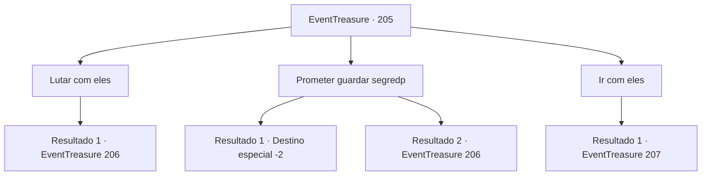

# Eventos de tesouro · 205

[Índice da tabela](index.md) · [Índice geral](../index.md)

ID: `pt:EventTreasure:205` · Fonte: `EventTreasure4` · Versão: 1.2.47.

Mapeamento estático dos arquivos; a disponibilidade e a execução dependem do estado da run.

## Texto do evento

*Sem texto no arquivo.*

## Dados de entrada

```json
{
  "id": 205,
  "grade": 1,
  "place": "",
  "required": ""
}
```

## Mapa das escolhas



## Escolhas e resultados

### Escolha 1

Lutar com eles

Requisitos e outros campos da escolha:

```json
{
  "required": ""
}
```

#### Resultado 1.1

Decide lutar contra os Hassassins. Eles te cercam e começam a brandir suas adagas.

Continuação registrada: [Evento 206](0206.md) na mesma tabela.

```json
{
  "required": "",
  "chance": "1",
  "nextEvent": 206,
  "type": 2,
  "reward": "6_3_48",
  "place": 10
}
```

### Escolha 2

Prometer guardar segredp

Requisitos e outros campos da escolha:

```json
{
  "required": ""
}
```

#### Resultado 2.1

Você promete aos Hassassins que guardará o segredo. Eles te olham e assentem como se estivessem hipnotizados. 

 "Mmm... Nesse caso..."

 "É decepcionante, mas não há nada que possamos fazer."

 Você se despede e sai tranquilamente da pousada.

Continuação registrada: [Destino especial `-2`](../destinos-especiais.md).

```json
{
  "required": "",
  "chance": "1|0_12_1",
  "nextEvent": -2,
  "type": 0,
  "reward": "5_571_9"
}
```

#### Resultado 2.2

Você promete aos Hassassins que guardará o segredo. No entanto, eles simplesmente zombam como se achassem absurdo. 

 "Você acha que somos idiotas? Como podemos confiar no que você diz?"

 Eles te cercam e começam a brandir suas adagas.

Continuação registrada: [Evento 206](0206.md) na mesma tabela.

```json
{
  "required": "",
  "chance": "18",
  "nextEvent": 206,
  "type": 1,
  "reward": "6_3_48",
  "place": 10
}
```

### Escolha 3

Ir com eles

Requisitos e outros campos da escolha:

```json
{
  "required": ""
}
```

#### Resultado 3.1

Você pensa novamente e decide se juntar a eles. Eles se dirigem à praça onde os cidadãos estão reunidos, e você decide se infiltrar na fortaleza através do passagem secreta. A passagem secreta está conectada aos esgotos da cidade. Você avança enquanto suporta o mau cheiro dos esgotos e descobre a passagem secreta que viu no mapa. Dez minutos depois, você segue a passagem secreta até a adega de vinhos da fortaleza. Há fileiras de barris de carvalho para envelhecer o vinho na adega, e um 'Hassassin' de 'Red Rock', que parece estar vigiando qualquer um que entre, está parado ali.

Continuação registrada: [Evento 207](0207.md) na mesma tabela.

```json
{
  "required": "",
  "chance": "1",
  "nextEvent": 207,
  "type": 2,
  "reward": ""
}
```

## Referências que chegam a este evento

- [Evento 204 · escolha 2 · resultado 1](0204.md#escolha-2)
