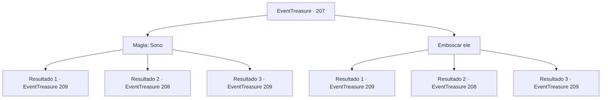

# Eventos de tesouro · 207

[Índice da tabela](index.md) · [Índice geral](../index.md)

ID: `pt:EventTreasure:207` · Fonte: `EventTreasure4` · Versão: 1.2.47.

Mapeamento estático dos arquivos; a disponibilidade e a execução dependem do estado da run.

## Texto do evento

*Sem texto no arquivo.*

## Dados de entrada

```json
{
  "id": 207,
  "grade": 1,
  "place": "",
  "required": ""
}
```

## Mapa das escolhas



## Escolhas e resultados

### Escolha 1

Magia: Sono

Requisitos e outros campos da escolha:

```json
{
  "required": "20_0_2"
}
```

#### Resultado 1.1

Lança um feitiço para fazer o Hassassin dormir. Ele caiu como uma marionete depois que suas cordas foram cortadas, e você esconde seu corpo no canto da adega de vinhos. Então você sai da adega e segue o corredor secreto. Enquanto segue as tochas nas paredes, você encontra uma escada que sobe para o andar de cima no final do corredor. E há uma porta de madeira no topo da escada.

Continuação registrada: [Evento 209](0209.md) na mesma tabela.

```json
{
  "required": "21_0_4",
  "chance": "1|0_7_1|0_12_1",
  "nextEvent": 209,
  "type": 0,
  "reward": ""
}
```

#### Resultado 1.2

Lanças um feitiço para fazer o Hassassin dormir. Mas falhas e acabas revelando a tua localização. 

 "Quem está aí?!"

 Ele tira a espada curta da cintura e avança em tua direção.

Continuação registrada: [Evento 208](0208.md) na mesma tabela.

```json
{
  "required": "21_0_4",
  "chance": "22",
  "nextEvent": 208,
  "type": 1,
  "reward": "6_0_48",
  "place": 7
}
```

#### Resultado 1.3

Lança um feitiço para fazer o Hassassin dormir. Ele caiu como uma marionete depois que suas cordas foram cortadas, e você esconde seu corpo no canto da adega de vinhos. Então você sai da adega e segue o corredor secreto. Enquanto segue as tochas nas paredes, você encontra uma escada que sobe para o andar de cima no final do corredor. E há uma porta de madeira no topo da escada.

Continuação registrada: [Evento 209](0209.md) na mesma tabela.

```json
{
  "required": "20_0_4",
  "chance": "1",
  "nextEvent": 209,
  "type": 2,
  "reward": ""
}
```

### Escolha 2

Emboscar ele

Requisitos e outros campos da escolha:

```json
{
  "required": ""
}
```

#### Resultado 2.1

Quando o Hassassin de guarda começa a bocejar, você se aproxima dele e rouba a espada curta de sua cintura. E antes que ele perceba, você corta sua garganta. Ele cai sem conseguir emitir nenhum som, e você esconde seu corpo no canto da adega de vinhos. Em seguida, sai da adega e segue o corredor secreto. Enquanto segue as tochas nas paredes, encontra uma escada que leva ao andar de cima no final do corredor. E há uma porta de madeira no topo da escada.

Continuação registrada: [Evento 209](0209.md) na mesma tabela.

```json
{
  "required": "21_5_4",
  "chance": "1|0_6_1",
  "nextEvent": 209,
  "type": 0,
  "reward": ""
}
```

#### Resultado 2.2

Quando o Hasssassin de guarda começa a bocejar, você tenta pegar a espada curta de sua cintura. Mas ele foi mais rápido em perceber sua presença. 

 "Quem está aí?"

 Ele tira a espada curta de sua cintura e se lança em sua direção.

Continuação registrada: [Evento 208](0208.md) na mesma tabela.

```json
{
  "required": "21_5_4",
  "chance": "20",
  "nextEvent": 208,
  "type": 1,
  "reward": "6_0_48",
  "place": 7
}
```

#### Resultado 2.3

Quando o Hassassin de guarda começa a bocejar, você se aproxima dele e rouba a espada curta de sua cintura. E antes que ele perceba, você corta sua garganta. Ele cai sem conseguir emitir nenhum som, e você esconde seu corpo no canto da adega de vinhos. Em seguida, sai da adega e segue o corredor secreto. Enquanto segue as tochas nas paredes, encontra uma escada que leva ao andar de cima no final do corredor. E há uma porta de madeira no topo da escada.

Continuação registrada: [Evento 209](0209.md) na mesma tabela.

```json
{
  "required": "20_5_4",
  "chance": "1",
  "nextEvent": 209,
  "type": 2,
  "reward": ""
}
```

## Referências que chegam a este evento

- [Evento 204 · escolha 1 · resultado 1](0204.md#escolha-1)
- [Evento 205 · escolha 3 · resultado 1](0205.md#escolha-3)
