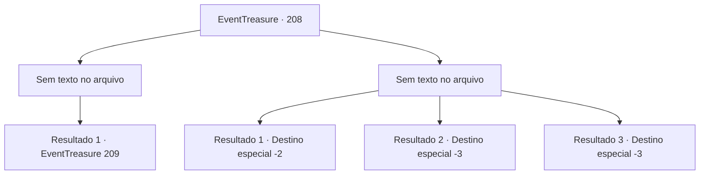

# Eventos de tesouro · 208

[Índice da tabela](index.md) · [Índice geral](../index.md)

ID: `pt:EventTreasure:208` · Fonte: `EventTreasure4` · Versão: 1.2.47.

Mapeamento estático dos arquivos; a disponibilidade e a execução dependem do estado da run.

## Texto do evento

*Sem texto no arquivo.*

## Dados de entrada

```json
{
  "id": 208,
  "grade": 1,
  "place": "",
  "required": ""
}
```

## Mapa das escolhas



## Escolhas e resultados

### Escolha 1

*Sem texto no arquivo; o papel dessa opção depende da interface do jogo.*

Requisitos e outros campos da escolha:

```json
{
  "required": ""
}
```

#### Resultado 1.1

Você mata o Hassassin que estava de guarda. Foi bastante barulhento, mas felizmente ninguém mais te descobriu. Você esconde o corpo dele no canto da adega de vinhos. Depois sai da adega e segue o corredor secreto. Enquanto segue as tochas nas paredes, você encontra uma escada que sobe para o andar de cima no final do corredor. E há uma porta de madeira no topo da escada.

Continuação registrada: [Evento 209](0209.md) na mesma tabela.

```json
{
  "required": "",
  "chance": "1",
  "nextEvent": 209,
  "type": 2,
  "reward": ""
}
```

### Escolha 2

*Sem texto no arquivo; o papel dessa opção depende da interface do jogo.*

Requisitos e outros campos da escolha:

```json
{
  "required": ""
}
```

#### Resultado 2.1

Corra para o esgoto depois de ser perseguido pelo Hassassin da Rocha Vermelha. Ele para de te perseguir como se tivesse te perdido no meio do caminho, e você segue esse caminho para fugir da cidade.

Continuação registrada: [Destino especial `-2`](../destinos-especiais.md).

```json
{
  "required": "1_0_2|1_1_2",
  "chance": "1",
  "nextEvent": -2,
  "type": 2,
  "reward": "0_0_-1|0_1_-1|5_571_9"
}
```

#### Resultado 2.2

Você se torna um cadáver depois de ser apunhalado pelas adagas do Hassassin.

Continuação registrada: [Destino especial `-3`](../destinos-especiais.md).

```json
{
  "required": "2_0_2",
  "chance": "1",
  "nextEvent": -3,
  "type": 2,
  "reward": "0_0_-1|0_1_-1"
}
```

#### Resultado 2.3

Você se torna um cadáver depois de ser apunhalado pelas adagas do Hassassin.

Continuação registrada: [Destino especial `-3`](../destinos-especiais.md).

```json
{
  "required": "2_1_2",
  "chance": "1",
  "nextEvent": -3,
  "type": 2,
  "reward": "0_0_-1|0_1_-1"
}
```

## Referências que chegam a este evento

- [Evento 207 · escolha 1 · resultado 2](0207.md#escolha-1)
- [Evento 207 · escolha 2 · resultado 2](0207.md#escolha-2)
