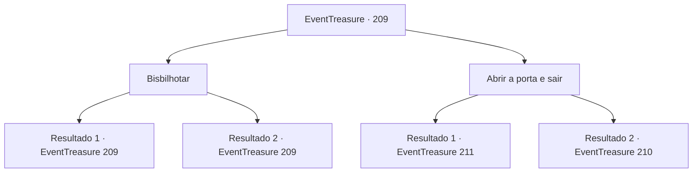

# Eventos de tesouro · 209

[Índice da tabela](index.md) · [Índice geral](../index.md)

ID: `pt:EventTreasure:209` · Fonte: `EventTreasure4` · Versão: 1.2.47.

Mapeamento estático dos arquivos; a disponibilidade e a execução dependem do estado da run.

## Texto do evento

*Sem texto no arquivo.*

## Dados de entrada

```json
{
  "id": 209,
  "grade": 1,
  "place": "",
  "required": ""
}
```

## Mapa das escolhas



## Escolhas e resultados

### Escolha 1

Bisbilhotar

Requisitos e outros campos da escolha:

```json
{
  "required": "5_573_0"
}
```

#### Resultado 1.1

Você coloca silenciosamente seus ouvidos na porta. Em seguida, você ouve um murmúrio suave. 

 "...Alguém deve tê-los agitado."

 "Como ousam protestar? Devemos capturar o líder e matá-lo!"

 Enquanto os membros da Rocha Vermelha falam em tom áspero, você percebe que eles estão se movendo para lidar com a confusão lá fora, julgando pelas vozes que ficam mais silenciosas.

Continuação registrada: [Evento 209](0209.md) na mesma tabela.

```json
{
  "required": "",
  "chance": "1|0_14_1",
  "nextEvent": 209,
  "type": 0,
  "reward": "5_573_1"
}
```

#### Resultado 1.2

Você coloca silenciosamente seus ouvidos na porta. No entanto, você não ouve nada.

Continuação registrada: [Evento 209](0209.md) na mesma tabela.

```json
{
  "required": "",
  "chance": "16",
  "nextEvent": 209,
  "type": 1,
  "reward": "5_573_2"
}
```

### Escolha 2

Abrir a porta e sair

Requisitos e outros campos da escolha:

```json
{
  "required": ""
}
```

#### Resultado 2.1

Você espera um momento até que o som das pessoas desapareça completamente e atravessa a porta. Como mostrado no plano, a adega de vinhos estava conectada à cozinha. Depois de olhar ao redor da cozinha, você descobre uma polia para enviar a comida para cima. Há uma cesta na polia que parece ser onde a comida é colocada, e há uma alavanca que você pode girar com as mãos instalada na frente. Enquanto você gira a alavanca, a cesta vazia começa a subir lentamente e você rapidamente entra na cesta. Com um barulho de rangido, a corrente que segura a cesta te leva para o quarto de Karadeniz. Há um tapete vermelho elegante no quarto de Karadeniz, e cabeças de todos os tipos de animais penduradas na parede. Além disso, todas as janelas estavam estranhamente cobertas com placas de madeira. Um homem, que parece ser Karadeniz, está sentado em um sofá de veludo no meio do quarto, e parece que está fumando maconha. Ele te vê e se levanta lentamente. Então ele te olha fixamente com os olhos afundados. 

 "Pensei que ia conseguir algo para comer porque você veio da cozinha... Sente-se. Vamos conversar."


Continuação registrada: [Evento 211](0211.md) na mesma tabela.

```json
{
  "required": "5_573_1",
  "chance": "1",
  "nextEvent": 211,
  "type": 2,
  "reward": ""
}
```

#### Resultado 2.2

Você entra pela porta. Em seguida, um Hassassin na cozinha te descobre e grita. 

 "O que foi isso? Quem está aí?!"

 Então ele imediatamente puxa a cimitarra presa em sua cintura e se lança em sua direção.

Continuação registrada: [Evento 210](0210.md) na mesma tabela.

```json
{
  "required": "18_573_1",
  "chance": "1",
  "nextEvent": 210,
  "type": 2,
  "reward": "6_0_48",
  "place": 10
}
```

## Referências que chegam a este evento

- [Evento 207 · escolha 1 · resultado 1](0207.md#escolha-1)
- [Evento 207 · escolha 1 · resultado 3](0207.md#escolha-1)
- [Evento 207 · escolha 2 · resultado 1](0207.md#escolha-2)
- [Evento 207 · escolha 2 · resultado 3](0207.md#escolha-2)
- [Evento 208 · escolha 1 · resultado 1](0208.md#escolha-1)
- [Evento 209 · escolha 1 · resultado 1](0209.md#escolha-1)
- [Evento 209 · escolha 1 · resultado 2](0209.md#escolha-1)
