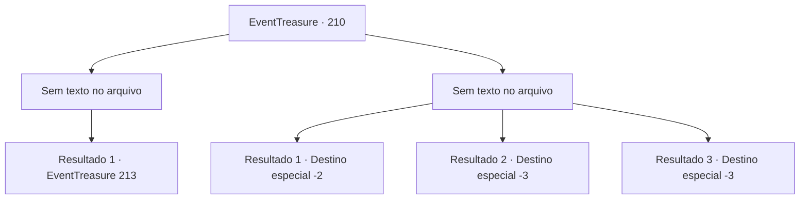

# Eventos de tesouro · 210

[Índice da tabela](index.md) · [Índice geral](../index.md)

ID: `pt:EventTreasure:210` · Fonte: `EventTreasure4` · Versão: 1.2.47.

Mapeamento estático dos arquivos; a disponibilidade e a execução dependem do estado da run.

## Texto do evento

*Sem texto no arquivo.*

## Dados de entrada

```json
{
  "id": 210,
  "grade": 1,
  "place": "",
  "required": ""
}
```

## Mapa das escolhas



## Escolhas e resultados

### Escolha 1

*Sem texto no arquivo; o papel dessa opção depende da interface do jogo.*

Requisitos e outros campos da escolha:

```json
{
  "required": ""
}
```

#### Resultado 1.1

Silencie o Hassassin que guarda a cozinha. Com todo esse barulho, os Hassassins próximos se reúnem. 

 "Intruso! Peguem ele!"

 Uma faca vem em sua direção pela frente e flechas por trás. Depois de ser encurralado, você percebe que só tem duas opções. Uma é fugir para o esgoto, e a outra é matar cada um deles.

Continuação registrada: [Evento 213](0213.md) na mesma tabela.

```json
{
  "required": "",
  "chance": "1",
  "nextEvent": 213,
  "type": 2,
  "reward": ""
}
```

### Escolha 2

*Sem texto no arquivo; o papel dessa opção depende da interface do jogo.*

Requisitos e outros campos da escolha:

```json
{
  "required": ""
}
```

#### Resultado 2.1

Para evitar o ataque do Hassassin, você finalmente consegue escapar através do esgoto.  Ele acaba se perdendo enquanto te persegue como se não estivesse familiarizado com os túneis subterrâneos,  e graças a isso você consegue escapar em segurança da fortaleza.

Continuação registrada: [Destino especial `-2`](../destinos-especiais.md).

```json
{
  "required": "1_0_2|1_1_2",
  "chance": "1",
  "nextEvent": -2,
  "type": 2,
  "reward": "0_0_-1|0_1_-1|5_571_9"
}
```

#### Resultado 2.2

Você se torna um cadáver depois de ser apunhalado pelas adagas do Hassassin.

Continuação registrada: [Destino especial `-3`](../destinos-especiais.md).

```json
{
  "required": "2_0_2",
  "chance": "1",
  "nextEvent": -3,
  "type": 2,
  "reward": "0_0_-1|0_1_-1"
}
```

#### Resultado 2.3

Você se torna um cadáver depois de ser apunhalado pelas adagas do Hassassin.

Continuação registrada: [Destino especial `-3`](../destinos-especiais.md).

```json
{
  "required": "2_1_2",
  "chance": "1",
  "nextEvent": -3,
  "type": 2,
  "reward": "0_0_-1|0_1_-1"
}
```

## Referências que chegam a este evento

- [Evento 209 · escolha 2 · resultado 2](0209.md#escolha-2)
