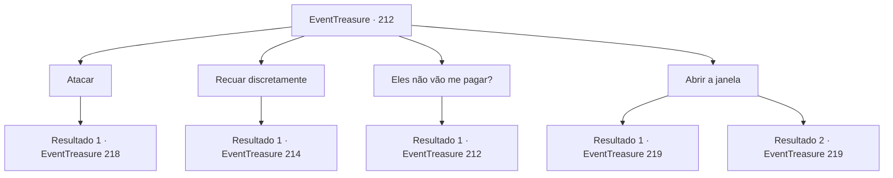

# Eventos de tesouro · 212

[Índice da tabela](index.md) · [Índice geral](../index.md)

ID: `pt:EventTreasure:212` · Fonte: `EventTreasure4` · Versão: 1.2.47.

Mapeamento estático dos arquivos; a disponibilidade e a execução dependem do estado da run.

## Texto do evento

*Sem texto no arquivo.*

## Dados de entrada

```json
{
  "id": 212,
  "grade": 1,
  "place": "",
  "required": ""
}
```

## Mapa das escolhas



## Escolhas e resultados

### Escolha 1

Atacar

Requisitos e outros campos da escolha:

```json
{
  "required": ""
}
```

#### Resultado 1.1

Você o ataca. No entanto, ele evita seu ataque se dispersando na forma de morcegos. Os morcegos se reúnem atrás de você e assumem a forma de uma pessoa. 

 "Que temperamento..."

 Após um breve murmúrio, ele vai em direção ao seu pescoço com suas garras afiadas.

Continuação registrada: [Evento 218](0218.md) na mesma tabela.

```json
{
  "required": "",
  "chance": "1",
  "nextEvent": 218,
  "type": 2,
  "reward": "6_0_160",
  "place": 10
}
```

### Escolha 2

Recuar discretamente

Requisitos e outros campos da escolha:

```json
{
  "required": ""
}
```

#### Resultado 2.1

Você responde enquanto se afasta lentamente. Então ele aponta para a porta e diz: 

 "Saia por ali. Em vez de vagar por lugares estranhos."

 Você abre a porta para a qual ele apontou. Então os guardas que estão na frente da porta se assustam e apontam suas lanças para você. 

 "Quem é você?!"

 Com seu grito, Karadeniz afasta a lança e diz. 

 "Um convidado. O convidado está indo embora, então não atrapalhem o caminho. E... eu preciso falar com vocês."

 Depois que os guardas entraram, ele fechou a porta atrás deles. Você pode sair da fortaleza sem ser incomodado, como ele disse. Enquanto sai da fortaleza pela porta principal, você vê os cidadãos protestando. Então, os membros da Arena Dourada entre eles te reconhecem e se aproximam de você. 

 "Como foi? Você matou Karadeniz?"


Continuação registrada: [Evento 214](0214.md) na mesma tabela.

```json
{
  "required": "",
  "chance": "1",
  "nextEvent": 214,
  "type": 2,
  "reward": ""
}
```

### Escolha 3

Eles não vão me pagar?

Requisitos e outros campos da escolha:

```json
{
  "required": "5_520_0"
}
```

#### Resultado 3.1

Depois de você perguntar, ele ri às gargalhadas. 

 "É a verdade. Aqueles que fizeram o pedido não têm riqueza suficiente. Eles atraem um novato como você, usam o máximo que podem e não pagam. É assim que sempre fizeram e não será diferente com você."


Continuação registrada: [Evento 212](0212.md) na mesma tabela.

```json
{
  "required": "",
  "chance": "1",
  "nextEvent": 212,
  "type": 2,
  "reward": "5_520_1"
}
```

### Escolha 4

Abrir a janela

Requisitos e outros campos da escolha:

```json
{
  "required": "5_521_1"
}
```

#### Resultado 4.1

Você se aproxima lentamente da janela e remove a tábua de madeira que bloqueia a janela. Enquanto o pôr do sol entra pela janela, ele se levanta de um salto e grita. 

 "Maldito...!"

 Seu corpo começa a queimar e quando você bloqueia a porta para evitar que ele escape, ele fica furioso e te ataca.

Continuação registrada: [Evento 219](0219.md) na mesma tabela.

```json
{
  "required": "",
  "chance": "1|0_5_1",
  "nextEvent": 219,
  "type": 0,
  "reward": "6_2_160",
  "place": 10
}
```

#### Resultado 4.2

Você se aproxima lentamente da janela e tenta arrancar a tábua que bloqueia a janela. No entanto, a tábua não se move como se você não fosse forte o suficiente. Depois de te ver, Karadeniz mostra seus dentes e se lança sobre você.

Continuação registrada: [Evento 219](0219.md) na mesma tabela.

```json
{
  "required": "",
  "chance": "10",
  "nextEvent": 219,
  "type": 1,
  "reward": "6_0_160",
  "place": 10
}
```

## Referências que chegam a este evento

- [Evento 211 · escolha 1 · resultado 1](0211.md#escolha-1)
- [Evento 211 · escolha 1 · resultado 2](0211.md#escolha-1)
- [Evento 212 · escolha 3 · resultado 1](0212.md#escolha-3)
