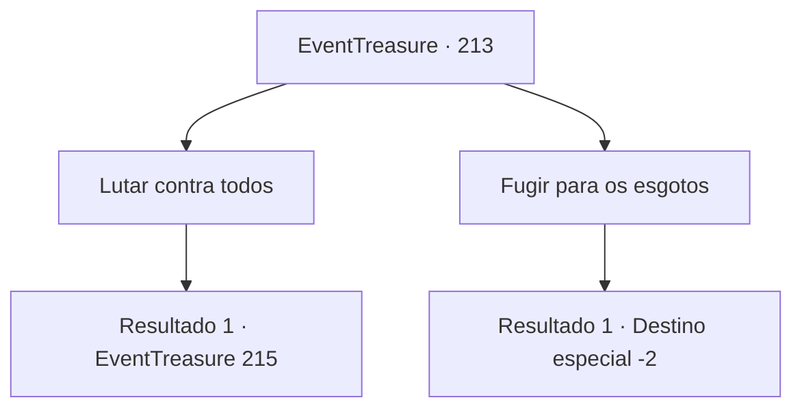

# Eventos de tesouro · 213

[Índice da tabela](index.md) · [Índice geral](../index.md)

ID: `pt:EventTreasure:213` · Fonte: `EventTreasure4` · Versão: 1.2.47.

Mapeamento estático dos arquivos; a disponibilidade e a execução dependem do estado da run.

## Texto do evento

*Sem texto no arquivo.*

## Dados de entrada

```json
{
  "id": 213,
  "grade": 1,
  "place": "",
  "required": ""
}
```

## Mapa das escolhas



## Escolhas e resultados

### Escolha 1

Lutar contra todos

Requisitos e outros campos da escolha:

```json
{
  "required": ""
}
```

#### Resultado 1.1

Com as coisas acontecendo dessa forma, você decide cuidar de todos. Em breve, os Hassassins e os guardas te cercam e começam a atacar.

Continuação registrada: [Evento 215](0215.md) na mesma tabela.

```json
{
  "required": "",
  "chance": "1",
  "nextEvent": 215,
  "type": 2,
  "reward": "6_0_136",
  "place": 10
}
```

### Escolha 2

Fugir para os esgotos

Requisitos e outros campos da escolha:

```json
{
  "required": ""
}
```

#### Resultado 2.1

Corra através do esgoto. Aqueles que te perseguem te perdem depois de se perderem no labirinto do esgoto, e você consegue escapar do forte de forma segura.

Continuação registrada: [Destino especial `-2`](../destinos-especiais.md).

```json
{
  "required": "",
  "chance": "1",
  "nextEvent": -2,
  "type": 2,
  "reward": "5_571_9"
}
```

## Referências que chegam a este evento

- [Evento 210 · escolha 1 · resultado 1](0210.md#escolha-1)
