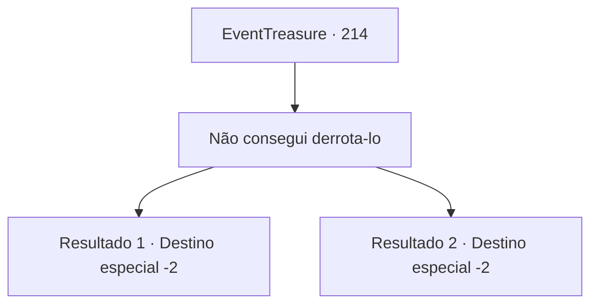

# Eventos de tesouro · 214

[Índice da tabela](index.md) · [Índice geral](../index.md)

ID: `pt:EventTreasure:214` · Fonte: `EventTreasure4` · Versão: 1.2.47.

Mapeamento estático dos arquivos; a disponibilidade e a execução dependem do estado da run.

## Texto do evento

*Sem texto no arquivo.*

## Dados de entrada

```json
{
  "id": 214,
  "grade": 1,
  "place": "",
  "required": ""
}
```

## Mapa das escolhas



## Escolhas e resultados

### Escolha 1

Não consegui derrota-lo

Requisitos e outros campos da escolha:

```json
{
  "required": ""
}
```

#### Resultado 1.1

Ele estremece e suspira diante da sua resposta. 

 "Suspiro... Entendo. Não será fácil. Eu esperava por isso. Suponho que não se pode evitar. Mas aguardo ansiosamente pela próxima oportunidade."

 Depois de se despedir, ele volta para a multidão, e você também deixa a cidade depois de se separar dele.

Continuação registrada: [Destino especial `-2`](../destinos-especiais.md).

```json
{
  "required": "18_522_1",
  "chance": "1",
  "nextEvent": -2,
  "type": 2,
  "reward": "5_571_9"
}
```

#### Resultado 1.2

Embora você não tenha matado Karadeniz, mas você conta a eles o que aconteceu lá dentro. Então os olhos dos membros da Arena Dourada se tornam incrédulos. 

 "I-Isso não pode ser, você matou todos exceto Karadeniz...?"

 Resumindo, você os leva até a fortaleza e mostra que estava dizendo a verdade. Suas mandíbulas caem ao ver o interior da fortaleza ensanguentada. 

 "Vem aqui. Tenho que te dar sua recompensa."

 Você o segue de volta à pousada onde conheceu a Arena Dourada pela primeira vez. Depois de esperar um momento no quarto, os membros da Arena Dourada começam a se reunir um por um. Todos parecem surpresos ao ouvir o que você fez. Então um deles abre a boca. 

 "A Rocha de Sangue não existe mais a partir de hoje... Devemos considerar isso um trabalho bem feito. Bom trabalho. Foi bom ter te designado para a tarefa. Aqui, por favor, pegue isso."

 Então ele abre o baú e te entrega ouro e um ovo de grifo de dentro. 

 "Obrigado por sua ajuda. Vou espalhar a notícia de sua proeza."

 Você se despede deles e segue seu caminho.

Continuação registrada: [Destino especial `-2`](../destinos-especiais.md).

```json
{
  "required": "5_522_1",
  "chance": "1",
  "nextEvent": -2,
  "type": 2,
  "reward": "3_200_1|0_4_50|27_23_1"
}
```

## Referências que chegam a este evento

- [Evento 212 · escolha 2 · resultado 1](0212.md#escolha-2)
- [Evento 217 · escolha 2 · resultado 1](0217.md#escolha-2)
