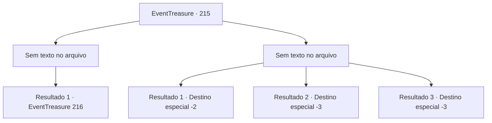

# Eventos de tesouro · 215

[Índice da tabela](index.md) · [Índice geral](../index.md)

ID: `pt:EventTreasure:215` · Fonte: `EventTreasure4` · Versão: 1.2.47.

Mapeamento estático dos arquivos; a disponibilidade e a execução dependem do estado da run.

## Texto do evento

*Sem texto no arquivo.*

## Dados de entrada

```json
{
  "id": 215,
  "grade": 1,
  "place": "",
  "required": ""
}
```

## Mapa das escolhas



## Escolhas e resultados

### Escolha 1

*Sem texto no arquivo; o papel dessa opção depende da interface do jogo.*

Requisitos e outros campos da escolha:

```json
{
  "required": ""
}
```

#### Resultado 1.1

Com uma violência avassaladora, você é capaz de matar todos os inimigos que te atacaram. Eles caem mortos diante de você ou fogem do forte. O forte construído com tijolos de areia amarela é tingido de carmesim pelo sangue. Você passa pelo poço de sangue e sobe as escadas. Em seguida, abre a porta localizada no final. Quando você abre a grossa porta de madeira, há um quarto escuro. Há um elegante tapete vermelho no quarto e cabeças de todos os tipos de animais penduradas na parede. Além disso, todas as janelas estavam estranhamente cobertas com placas de madeira. Um homem, que se parece com Karadeniz, está sentado em um sofá de veludo no meio do quarto, e parece que está fumando maconha. Ele te vê e se levanta lentamente. Então ele te olha fixamente com olhos afundados. 

 "Sente-se. Vamos conversar."


Continuação registrada: [Evento 216](0216.md) na mesma tabela.

```json
{
  "required": "",
  "chance": "1",
  "nextEvent": 216,
  "type": 2,
  "reward": "5_522_1"
}
```

### Escolha 2

*Sem texto no arquivo; o papel dessa opção depende da interface do jogo.*

Requisitos e outros campos da escolha:

```json
{
  "required": ""
}
```

#### Resultado 2.1

Eventualmente, você escapa pelo esgoto com ferimentos por todo o corpo. Eles te perseguiram pelo esgoto, mas acabaram te perdendo devido ao labirinto do esgoto.

Continuação registrada: [Destino especial `-2`](../destinos-especiais.md).

```json
{
  "required": "1_0_2|1_1_2",
  "chance": "1",
  "nextEvent": -2,
  "type": 2,
  "reward": "0_0_-1|0_1_-1|5_571_9"
}
```

#### Resultado 2.2

Eventualmente, você se torna um pedaço de carne depois de ser despedaçado por suas armas.

Continuação registrada: [Destino especial `-3`](../destinos-especiais.md).

```json
{
  "required": "2_0_2",
  "chance": "1",
  "nextEvent": -3,
  "type": 2,
  "reward": "0_0_-1|0_1_-1"
}
```

#### Resultado 2.3

Eventualmente, você se torna um pedaço de carne depois de ser despedaçado por suas armas.

Continuação registrada: [Destino especial `-3`](../destinos-especiais.md).

```json
{
  "required": "2_1_2",
  "chance": "1",
  "nextEvent": -3,
  "type": 2,
  "reward": "0_0_-1|0_1_-1"
}
```

## Referências que chegam a este evento

- [Evento 213 · escolha 1 · resultado 1](0213.md#escolha-1)
