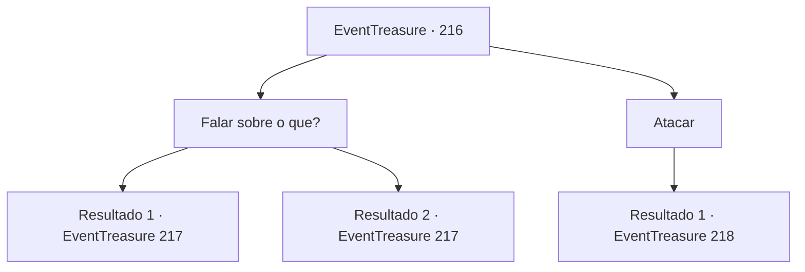

# Eventos de tesouro · 216

[Índice da tabela](index.md) · [Índice geral](../index.md)

ID: `pt:EventTreasure:216` · Fonte: `EventTreasure4` · Versão: 1.2.47.

Mapeamento estático dos arquivos; a disponibilidade e a execução dependem do estado da run.

## Texto do evento

*Sem texto no arquivo.*

## Dados de entrada

```json
{
  "id": 216,
  "grade": 1,
  "place": "",
  "required": ""
}
```

## Mapa das escolhas



## Escolhas e resultados

### Escolha 1

Falar sobre o que?

Requisitos e outros campos da escolha:

```json
{
  "required": ""
}
```

#### Resultado 1.1

Ele responde à sua pergunta com uma voz relaxada. 

 "Bem... Há tanta gente tentando tomar o meu lugar. Estou cansado disso. Então, quanto você está recebendo?"

 Ele não espera sua resposta e adiciona imediatamente. 

 "Haha. Acho que não importa quanto dinheiro tenham te prometido. Porque eles nunca vão te dar."

 Ele inala a fumaça e continua. 

 "Eu sou pacifista. Você deve ser bastante habilidoso para ter chegado até aqui. Se você sair em silêncio... eu vou deixar você viver."


Continuação registrada: [Evento 217](0217.md) na mesma tabela.

```json
{
  "required": "2_14_12",
  "chance": "1",
  "nextEvent": 217,
  "type": 2,
  "reward": ""
}
```

#### Resultado 1.2

Ele responde à sua pergunta com um tom de voz relaxado. 

 "Bem... Há tanta gente tentando tomar o meu lugar. Estou cansado disso. Então, quanto você está conseguindo?"

 Ele não espera sua resposta e adiciona imediatamente. 

 "Haha. Acho que não importa quanto dinheiro tenham te prometido. Porque eles nunca vão te dar."

 Ele inala a fumaça e continua. 

 "Eu sou pacifista. Você parece ser muito habilidoso, já que meus homens não conseguiram te fazer nada. Eu quero evitar lutar com você. Espero que você me deixe ir em silêncio..."

 Você o observa lentamente enquanto ele fala. Pele pálida escondida atrás da maquiagem, dentes e unhas afiados, e janelas cobertas para que a luz do sol não entre. Você percebe que ele é um vampiro.

Continuação registrada: [Evento 217](0217.md) na mesma tabela.

```json
{
  "required": "1_14_12",
  "chance": "1",
  "nextEvent": 217,
  "type": 2,
  "reward": "5_521_1"
}
```

### Escolha 2

Atacar

Requisitos e outros campos da escolha:

```json
{
  "required": ""
}
```

#### Resultado 2.1

Imediatamente você o ataca. No entanto, ele evita seu ataque se dispersando na forma de morcegos. Os morcegos se reúnem atrás de você e tomam a forma de uma pessoa. 

 "Que temperamento..."

 Após um breve murmúrio, ele vai em direção ao seu pescoço com suas unhas afiadas.

Continuação registrada: [Evento 218](0218.md) na mesma tabela.

```json
{
  "required": "",
  "chance": "1",
  "nextEvent": 218,
  "type": 2,
  "reward": "6_0_160",
  "place": 10
}
```

## Referências que chegam a este evento

- [Evento 215 · escolha 1 · resultado 1](0215.md#escolha-1)
