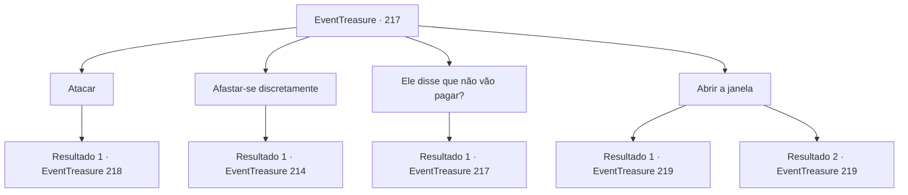

# Eventos de tesouro · 217

[Índice da tabela](index.md) · [Índice geral](../index.md)

ID: `pt:EventTreasure:217` · Fonte: `EventTreasure4` · Versão: 1.2.47.

Mapeamento estático dos arquivos; a disponibilidade e a execução dependem do estado da run.

## Texto do evento

*Sem texto no arquivo.*

## Dados de entrada

```json
{
  "id": 217,
  "grade": 1,
  "place": "",
  "required": ""
}
```

## Mapa das escolhas



## Escolhas e resultados

### Escolha 1

Atacar

Requisitos e outros campos da escolha:

```json
{
  "required": ""
}
```

#### Resultado 1.1

Você o ataca. No entanto, ele evita seu ataque se dispersando na forma de morcegos. Os morcegos se reúnem atrás de você e assumem a forma de uma pessoa. 

 "Que temperamento..."

 Após um breve murmúrio, ele vai em direção ao seu pescoço com suas garras afiadas.

Continuação registrada: [Evento 218](0218.md) na mesma tabela.

```json
{
  "required": "",
  "chance": "1",
  "nextEvent": 218,
  "type": 2,
  "reward": "6_0_160",
  "place": 10
}
```

### Escolha 2

Afastar-se discretamente

Requisitos e outros campos da escolha:

```json
{
  "required": ""
}
```

#### Resultado 2.1

Você responde enquanto se afasta lentamente. Em seguida, ele procura na gaveta e tira um pingente. 

 "Pegue isso. É importante, é meu sinal de gratidão por me fazer um favor."

 Você pega o pingente que ele entregou e sai do forte. Enquanto sai da fortaleza pela porta principal, você vê os cidadãos protestando. Em seguida, os membros da Arena Dourada entre eles te reconhecem e se aproximam de você. 

 "Como foi? Você matou Karadeniz?"


Continuação registrada: [Evento 214](0214.md) na mesma tabela.

```json
{
  "required": "",
  "chance": "1",
  "nextEvent": 214,
  "type": 2,
  "reward": ""
}
```

### Escolha 3

Ele disse que não vão pagar?

Requisitos e outros campos da escolha:

```json
{
  "required": "5_520_0"
}
```

#### Resultado 3.1

Depois de você perguntar, ele ri às gargalhadas. 

 "É a verdade. Aqueles que fizeram o pedido não têm riqueza suficiente. Eles atraem um novato como você, usam o máximo que podem e não pagam. É assim que sempre fizeram e não será diferente com você."


Continuação registrada: [Evento 217](0217.md) na mesma tabela.

```json
{
  "required": "",
  "chance": "1",
  "nextEvent": 217,
  "type": 2,
  "reward": "5_520_1"
}
```

### Escolha 4

Abrir a janela

Requisitos e outros campos da escolha:

```json
{
  "required": "5_521_1"
}
```

#### Resultado 4.1

Você se aproxima lentamente da janela e remove a tábua de madeira que bloqueia a janela. Enquanto o pôr do sol entra pela janela, ele se levanta de um salto e grita. 

 "Maldito...!"

 Seu corpo começa a queimar e quando você bloqueia a porta para evitar que ele escape, ele fica furioso e te ataca.

Continuação registrada: [Evento 219](0219.md) na mesma tabela.

```json
{
  "required": "",
  "chance": "1|0_5_1",
  "nextEvent": 219,
  "type": 0,
  "reward": "6_2_160",
  "place": 10
}
```

#### Resultado 4.2

Você se aproxima lentamente da janela e tenta arrancar a tábua que bloqueia a janela. No entanto, a tábua não se move como se você não fosse forte o suficiente. Depois de te ver, Karadeniz mostra seus dentes e se lança sobre você.

Continuação registrada: [Evento 219](0219.md) na mesma tabela.

```json
{
  "required": "",
  "chance": "10",
  "nextEvent": 219,
  "type": 1,
  "reward": "6_0_160",
  "place": 10
}
```

## Referências que chegam a este evento

- [Evento 216 · escolha 1 · resultado 1](0216.md#escolha-1)
- [Evento 216 · escolha 1 · resultado 2](0216.md#escolha-1)
- [Evento 217 · escolha 3 · resultado 1](0217.md#escolha-3)
