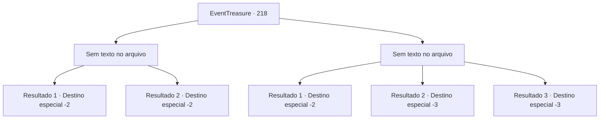

# Eventos de tesouro · 218

[Índice da tabela](index.md) · [Índice geral](../index.md)

ID: `pt:EventTreasure:218` · Fonte: `EventTreasure4` · Versão: 1.2.47.

Mapeamento estático dos arquivos; a disponibilidade e a execução dependem do estado da run.

## Texto do evento

*Sem texto no arquivo.*

## Dados de entrada

```json
{
  "id": 218,
  "grade": 1,
  "place": "",
  "required": ""
}
```

## Mapa das escolhas



## Escolhas e resultados

### Escolha 1

*Sem texto no arquivo; o papel dessa opção depende da interface do jogo.*

Requisitos e outros campos da escolha:

```json
{
  "required": ""
}
```

#### Resultado 1.1

Você derrota Karadeniz. No entanto, ele se dispersa em uma horda de morcegos e escapa pela chaminé. Você sai do quarto, vai para a cozinha, passa pela adega de vinhos e escapa do forte. Em seguida, você vai para a pousada onde conheceu Golden Sand antes. Ninguém chegou ainda, então você não tem outra opção senão esperar por eles. 

 Pouco depois que o protesto dos cidadãos terminou, Golden Sand entra na pousada. Eles te veem e perguntam o que aconteceu. Você diz a eles que derrotou Karadeniz, mas que ele era um vampiro e escapou. 

 "Justo como eu pensava...! Os rumores sobre ele comendo carne humana eram verdadeiros. Bom trabalho. Você não conseguiu matá-lo, mas ele não poderá voltar agora que foi revelado que ele era um vampiro. Aqui está sua recompensa."

 Então ele abre o baú e te entrega ouro e um ovo de grifo de dentro. 

 "Obrigado por sua ajuda. Vou espalhar a notícia de sua façanha."

 Você se despede deles e segue seu caminho.

Continuação registrada: [Destino especial `-2`](../destinos-especiais.md).

```json
{
  "required": "18_522_1",
  "chance": "1",
  "nextEvent": -2,
  "type": 2,
  "reward": "3_200_1|0_4_50|27_23_1"
}
```

#### Resultado 1.2

Matas a Karadeniz. No entanto, ele se dispersa em uma horda de morcegos e escapa pela chaminé. Você abre a porta e sai do forte. Enquanto deixa a fortaleza pela porta principal, você vê os cidadãos protestando. Em seguida, os membros da Arena Dourada te reconhecem e se aproximam de você. 

 "Como foi? Você matou Karadeniz?"

 Você o leva para o forte e mostra a ele a cena da matança. Então você explica o que aconteceu até agora. Ele fica de queixo caído ao ver o interior do sangrento forte. 

 "Vem aqui. Preciso te dar sua recompensa."

 Você o segue de volta para a pousada onde conheceu a Arena Dourada pela primeira vez. Depois de esperar um momento no quarto, os membros da Arena Dourada começam a se reunir um por um. Todos parecem surpresos ao ouvir o que você fez. Então um deles abre a boca. 

 "A Rocha de Sangue não existe mais a partir de hoje... Devemos considerar isso como um trabalho bem feito. Bom trabalho. Foi bom ter te confiado a tarefa. Aqui, por favor, pegue isso."

 Então ele abre o baú e te entrega ouro e um ovo de grifo de dentro. 

 "Obrigado por sua ajuda. Vou espalhar a notícia de sua proeza."

 Você se despede deles e segue seu caminho.

Continuação registrada: [Destino especial `-2`](../destinos-especiais.md).

```json
{
  "required": "5_522_1",
  "chance": "1",
  "nextEvent": -2,
  "type": 2,
  "reward": "3_200_1|0_4_50|27_23_1"
}
```

### Escolha 2

*Sem texto no arquivo; o papel dessa opção depende da interface do jogo.*

Requisitos e outros campos da escolha:

```json
{
  "required": ""
}
```

#### Resultado 2.1

Você não é capaz de resistir ao ataque do vampiro, então você se choca contra a janela bloqueada com tábuas com seu corpo e escapa pela janela. 

 "Argh... Maldito..."

 Ele recua para evitar a luz do sol, e você consegue escapar com segurança graças a isso.

Continuação registrada: [Destino especial `-2`](../destinos-especiais.md).

```json
{
  "required": "1_0_2|1_1_2",
  "chance": "1",
  "nextEvent": -2,
  "type": 2,
  "reward": "0_0_-1|0_1_-1|5_571_9"
}
```

#### Resultado 2.2

O vampiro morde seu pescoço com suas presas afiadas. Em seguida, ele bebe seu sangue. Pouco a pouco, você perde a consciência à medida que o sangue deixa seu corpo.

Continuação registrada: [Destino especial `-3`](../destinos-especiais.md).

```json
{
  "required": "2_0_2",
  "chance": "1",
  "nextEvent": -3,
  "type": 2,
  "reward": "0_0_-1|0_1_-1"
}
```

#### Resultado 2.3

O vampiro morde seu pescoço com suas presas afiadas. Em seguida, ele bebe seu sangue. Pouco a pouco, você perde a consciência à medida que o sangue deixa seu corpo.

Continuação registrada: [Destino especial `-3`](../destinos-especiais.md).

```json
{
  "required": "2_1_2",
  "chance": "1",
  "nextEvent": -3,
  "type": 2,
  "reward": "0_0_-1|0_1_-1"
}
```

## Referências que chegam a este evento

- [Evento 211 · escolha 2 · resultado 1](0211.md#escolha-2)
- [Evento 212 · escolha 1 · resultado 1](0212.md#escolha-1)
- [Evento 216 · escolha 2 · resultado 1](0216.md#escolha-2)
- [Evento 217 · escolha 1 · resultado 1](0217.md#escolha-1)
