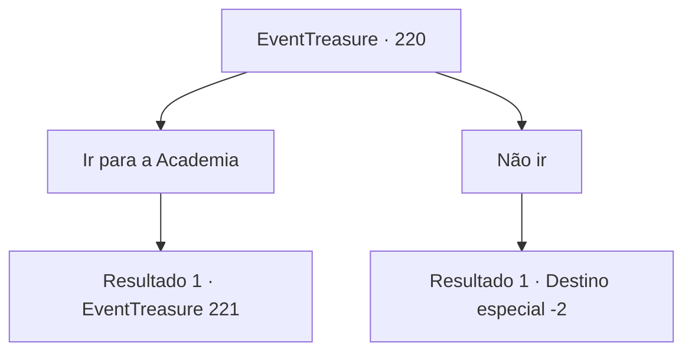

# Eventos de tesouro · 220

[Índice da tabela](index.md) · [Índice geral](../index.md)

ID: `pt:EventTreasure:220` · Fonte: `EventTreasure4` · Versão: 1.2.47.

Mapeamento estático dos arquivos; a disponibilidade e a execução dependem do estado da run.

## Texto do evento

Com um som vibrante, uma coruja de penas brancas voa em sua direção. Ela esta usando um monóculo incomum em seu rosto. Quando você estica o braço, a coruja pousa e aponta com seu bico para um de seus pés. Tem um pergaminho amarrado em seu pé por uma fita vermelha. Quando você retira, o pergaminha flutua no ar e se abre sozinho. As letras escritas começam a brilhar e você ouve uma voz. 

 "Vou direto ao ponto. A 127ª Conferência de Magia acontecerá em breve. A Academia Imperial de Magia avaliou muito bem seu conhecimento e experiência e esperamos que você atenda a chamada."


## Dados de entrada

```json
{
  "id": 220,
  "grade": 2,
  "place": "",
  "required": "1_2_50|5_526_0|26_12_1"
}
```

## Mapa das escolhas



## Escolhas e resultados

### Escolha 1

Ir para a Academia

Requisitos e outros campos da escolha:

```json
{
  "required": ""
}
```

#### Resultado 1.1

Você diz que irá para a Academia. Então, a voz volta a falar a partir do pergaminho. 

 "Ótimo. Nesse caso, venha para 'Weeset', a cidade dos mistérios."

 Com essas palavras, o pergaminho se rasga e um portal se abre. Você vê uma cidade além do portal, e parece ser Weeset, a que o pergaminho mencionou. |drawing_cityPortal| Você dá um passo em direção ao portal e chega lá se sentindo um pouco tonto. Ladrilhos cinzentos ordenados cobrem o chão da cidade, e talvez seja por causa do clima frio, mas há fileiras de prédios com telhados íngremes. E os prédios têm essa forma estranha onde o térreo é pequeno e fica maior à medida que você sobe. Enquanto você contempla a paisagem da cidade por um momento, a coruja voa para o céu e pousa no telhado de um prédio. Em seguida, ela mexe a cabeça como se estivesse te chamando para ir.

Continuação registrada: [Evento 221](0221.md) na mesma tabela.

```json
{
  "required": "",
  "chance": "1",
  "nextEvent": 221,
  "type": 2,
  "reward": "5_526_1"
}
```

### Escolha 2

Não ir

Requisitos e outros campos da escolha:

```json
{
  "required": ""
}
```

#### Resultado 2.1

Você expressa sua negativa. Em seguida, a voz fala novamente a partir do pergaminho. 

 "É uma pena. É uma grande oportunidade..."

 Após essas palavras, o pergaminho queima e desaparece. Então, a coruja salta do seu braço e voa para o céu.

Continuação registrada: [Destino especial `-2`](../destinos-especiais.md).

```json
{
  "required": "",
  "chance": "1",
  "nextEvent": -2,
  "type": 2,
  "reward": "5_526_9"
}
```

## Referências que chegam a este evento

Nenhum `nextEvent` positivo da mesma tabela aponta para este nó. Isso não prova que seja inacessível: sorteio e estado de história podem selecioná-lo.

