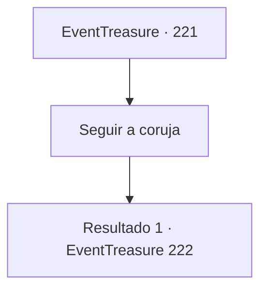

# Eventos de tesouro · 221

[Índice da tabela](index.md) · [Índice geral](../index.md)

ID: `pt:EventTreasure:221` · Fonte: `EventTreasure4` · Versão: 1.2.47.

Mapeamento estático dos arquivos; a disponibilidade e a execução dependem do estado da run.

## Texto do evento

*Sem texto no arquivo.*

## Dados de entrada

```json
{
  "id": 221,
  "grade": 1,
  "place": "",
  "required": ""
}
```

## Mapa das escolhas



## Escolhas e resultados

### Escolha 1

Seguir a coruja

Requisitos e outros campos da escolha:

```json
{
  "required": ""
}
```

#### Resultado 1.1

Siga a coruja e você chegará a um prédio. Quando você se aproxima da porta do prédio com um letreiro que diz 9 e 4/5. A face de uma coruja de bronze aparece da porta. Logo em seguida, a coruja de bronze abre os olhos para te observar e a porta se abre sozinha. 

 'rangido' 

 A pesada porta se abre e revela o salão principal do prédio. Perguntando-se que tipo de magia foi lançada sobre ele, o interior é muito mais espaçoso do que parece do lado de fora. Você entra no salão com todo tipo de peças de mármore e lustres luxuosos pendurados. Em seguida, a armadura de placa que está ao lado das escadas que levam para cima se aproxima de você. 

 "{1}. Bem-vindo. Por favor, me siga."

 Você segue a armadura em movimento, sobe a escada de veludo vermelho e entra em uma sala através de uma porta de madeira preta. O interior da sala tem a forma de um anfiteatro, com uma escada que leva a uma fileira de mesas, e um quadro negro grande e um púlpito na frente. Além disso, pessoas que parecem ser magos estão sentadas por toda parte conversando entre si.

Continuação registrada: [Evento 222](0222.md) na mesma tabela.

```json
{
  "required": "",
  "chance": "1",
  "nextEvent": 222,
  "type": 2,
  "reward": ""
}
```

## Referências que chegam a este evento

- [Evento 220 · escolha 1 · resultado 1](0220.md#escolha-1)
