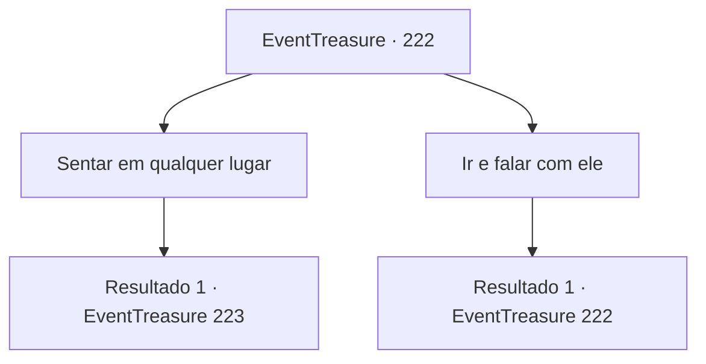

# Eventos de tesouro · 222

[Índice da tabela](index.md) · [Índice geral](../index.md)

ID: `pt:EventTreasure:222` · Fonte: `EventTreasure4` · Versão: 1.2.47.

Mapeamento estático dos arquivos; a disponibilidade e a execução dependem do estado da run.

## Texto do evento

*Sem texto no arquivo.*

## Dados de entrada

```json
{
  "id": 222,
  "grade": 1,
  "place": "",
  "required": ""
}
```

## Mapa das escolhas



## Escolhas e resultados

### Escolha 1

Sentar em qualquer lugar

Requisitos e outros campos da escolha:

```json
{
  "required": ""
}
```

#### Resultado 1.1

Você encontra um lugar aleatório para se sentar. Depois de esperar um pouco, um idoso sobe ao palco. 

 "Respeitados magos. Bem-vindos à Academia de Magia. Agora... Durante esta conferência, vamos analisar essa antiga magia."

 Ele move o giz com magia e começa a desenhar uma fórmula mágica no quadro. A complicada fórmula começa a cobrir um quadro e até se estende para outro quadro. Então os magos começam a sussurrar. 

 "Como esperado... Essa também parece muito difícil."

 Depois de escrever a fórmula, o idoso deixa o giz e diz. 

 "O feitiço escrito em um epitáfio foi encontrado por um estudante no meu laboratório, mas devido a algumas linhas terem sido destruídas e o feitiço ser muito antigo, espero poder decifrá-lo com a ajuda de vocês."

 Depois de falar, os magos começam a pensar enquanto rabiscam algo em suas anotações.

Continuação registrada: [Evento 223](0223.md) na mesma tabela.

```json
{
  "required": "",
  "chance": "1",
  "nextEvent": 223,
  "type": 2,
  "reward": ""
}
```

### Escolha 2

Ir e falar com ele

Requisitos e outros campos da escolha:

```json
{
  "required": "5_527_0"
}
```

#### Resultado 2.1

Você se aproxima de um dos grupos de magos para falar com eles. Em seguida, uma mulher de meia-idade te examina de cima a baixo e diz: 

 "Oh... Um aventureiro. É estranho, mas os aventureiros também vêm para a conferência. É um prazer te conhecer. Eu sou 'Ronelly'. Criei a magia que faz uma semente brotar. Hehe."

 Depois de sua saudação, as outras mulheres próximas também se apresentam a você. Todas mencionam que tipo de magia criaram, mas todas eram inúteis para um aventureiro como você, como a magia que corta os brotos de batata, a magia que embala um bebê chorando o suficiente para acalmá-lo e a magia que evita que a sopa derrame.

Continuação registrada: [Evento 222](0222.md) na mesma tabela.

```json
{
  "required": "",
  "chance": "1",
  "nextEvent": 222,
  "type": 2,
  "reward": "5_527_1"
}
```

## Referências que chegam a este evento

- [Evento 221 · escolha 1 · resultado 1](0221.md#escolha-1)
- [Evento 222 · escolha 2 · resultado 1](0222.md#escolha-2)
