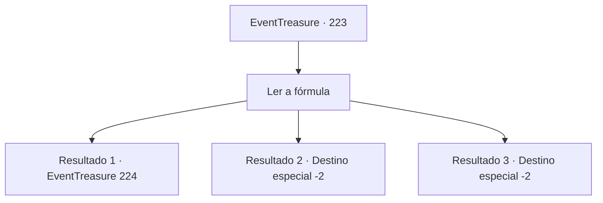

# Eventos de tesouro · 223

[Índice da tabela](index.md) · [Índice geral](../index.md)

ID: `pt:EventTreasure:223` · Fonte: `EventTreasure4` · Versão: 1.2.47.

Mapeamento estático dos arquivos; a disponibilidade e a execução dependem do estado da run.

## Texto do evento

*Sem texto no arquivo.*

## Dados de entrada

```json
{
  "id": 223,
  "grade": 1,
  "place": "",
  "required": ""
}
```

## Mapa das escolhas



## Escolhas e resultados

### Escolha 1

Ler a fórmula

Requisitos e outros campos da escolha:

```json
{
  "required": ""
}
```

#### Resultado 1.1

Leia a fórmula muito minuciosamente. Embora seja uma magia muito difícil e complicada, você encontra uma maneira de simplificar a fórmula. Você consegue simplificar a fórmula combinando fórmulas repetidas e adicionando condições no início e no final da fórmula. Você infere que o material especial deve ser escrito no trecho da seção danificada, mas ao considerar a forma feita a partir da fórmula, parece ser um material tipo tecido. Portanto, você percebe que isso é 'magia para tecer um cachecol sem agulha'. Você se aproxima do quadro e escreve a fórmula decifrada. Quando você anuncia a fórmula decifrada, os magos te aplaudem de pé. Então o velho mago que trouxe esse problema diz com um sorriso satisfeito. 

 "Você é incrível...! Gostaria de vir trabalhar no meu laboratório?"


Continuação registrada: [Evento 224](0224.md) na mesma tabela.

```json
{
  "required": "20_0_2",
  "chance": "1|0_7_1",
  "nextEvent": 224,
  "type": 0,
  "reward": ""
}
```

#### Resultado 1.2

Você leu a fórmula muito minuciosamente. No entanto, você não consegue decifrar a fórmula porque a magia é muito difícil e complicada. Não importa quanto tempo passe, não há ninguém que possa resolver a fórmula, e eventualmente, a conferência se dissolve sem nenhum resultado.

Continuação registrada: [Destino especial `-2`](../destinos-especiais.md).

```json
{
  "required": "20_0_2",
  "chance": "26",
  "nextEvent": -2,
  "type": 1,
  "reward": "5_526_9"
}
```

#### Resultado 1.3

Você leu a fórmula muito minuciosamente. No entanto, você não consegue decifrar a fórmula porque a magia é muito difícil e complicada. Não importa quanto tempo passe, não há ninguém que possa resolver a fórmula, e eventualmente, a conferência se dissolve sem nenhum resultado.

Continuação registrada: [Destino especial `-2`](../destinos-especiais.md).

```json
{
  "required": "21_0_2",
  "chance": "1",
  "nextEvent": -2,
  "type": 2,
  "reward": "5_526_9"
}
```

## Referências que chegam a este evento

- [Evento 222 · escolha 1 · resultado 1](0222.md#escolha-1)
