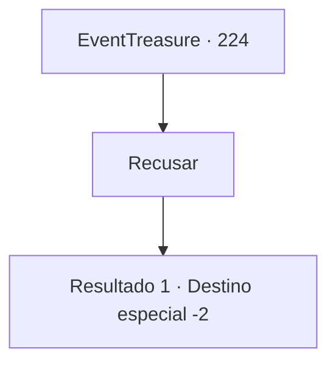

# Eventos de tesouro · 224

[Índice da tabela](index.md) · [Índice geral](../index.md)

ID: `pt:EventTreasure:224` · Fonte: `EventTreasure4` · Versão: 1.2.47.

Mapeamento estático dos arquivos; a disponibilidade e a execução dependem do estado da run.

## Texto do evento

*Sem texto no arquivo.*

## Dados de entrada

```json
{
  "id": 224,
  "grade": 1,
  "place": "",
  "required": ""
}
```

## Mapa das escolhas



## Escolhas e resultados

### Escolha 1

Recusar

Requisitos e outros campos da escolha:

```json
{
  "required": ""
}
```

#### Resultado 1.1

Você rejeita a oferta do velho mago porque precisa embarcar em uma aventura. Lambe os lábios com decepção. 

 "Agora... eu deveria te dar uma recompensa por decifrar essa antiga magia. Por favor, pegue isso."

 Ele traz uma longa caixa de madeira ao mover sua mão. A caixa feita de madeira negra, decorada com belos entalhes, tem um bastão de marfim sobre um luxuoso pano vermelho. 

 "Em reconhecimento às suas contribuições para o avanço da magia, nós lembraremos do seu nome."

 Você parte depois de receber aplausos dos magos e a recompensa.

Continuação registrada: [Destino especial `-2`](../destinos-especiais.md).

```json
{
  "required": "",
  "chance": "1",
  "nextEvent": -2,
  "type": 2,
  "reward": "5_526_9|3_168_1|27_32_1|0_2_1"
}
```

## Referências que chegam a este evento

- [Evento 223 · escolha 1 · resultado 1](0223.md#escolha-1)
