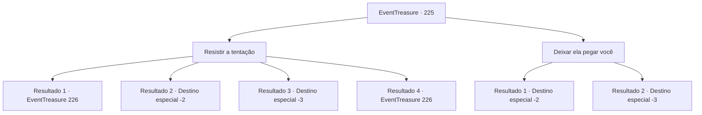

# Eventos de tesouro · 225

[Índice da tabela](index.md) · [Índice geral](../index.md)

ID: `pt:EventTreasure:225` · Fonte: `EventTreasure4` · Versão: 1.2.47.

Mapeamento estático dos arquivos; a disponibilidade e a execução dependem do estado da run.

## Texto do evento

Depois de estar caindo no sono, você sente alguém se levantando a sua frente. Quando você abre seus olhos, você ve uma bela mulher de frente pra você. Ela tem olhos vermelhos fascinantes, um nariz que parece ser esculpido, vivídos lábios, asas como de morcego, e uma cauda igual a um demônio. Você percebe que ela é uma súcubo. Ela fala com seu sorriso reconfortante. 

 "Haha, fique tranquilo. Eu vou cuidar de tudo."

 Ela chega mais perto e diz, acariciando seu rosto, dizendo para deixar tudo com ela. Você é abraçado, com uma energia estranha vindo dela.

## Dados de entrada

```json
{
  "id": 225,
  "grade": 2,
  "place": "",
  "required": "1_2_50|5_528_0|26_5_1"
}
```

## Mapa das escolhas



## Escolhas e resultados

### Escolha 1

Resistir a tentação

Requisitos e outros campos da escolha:

```json
{
  "required": ""
}
```

#### Resultado 1.1

Não resistas à tentação do súcubo. Em seguida, o súcubo parece surpreendido por um momento, mas recupera a compostura e abre a boca. 

 "Mmm... Não precisas ser tão cauteloso. Não te farei mal. Só quero que nos divirtamos."


Continuação registrada: [Evento 226](0226.md) na mesma tabela.

```json
{
  "required": "21_7_4|21_55_1",
  "chance": "1|0_12_1",
  "nextEvent": 226,
  "type": 0,
  "reward": "5_528_1"
}
```

#### Resultado 1.2

Tentas resistir a tentação do súcubo. No entanto, sua vontade se quebra com a energia que emana dela, e eventualmente, você permite que o súcubo te leve. 

 O sol nasce e você acorda muito exausto. A pessoa com quem passou uma noite intensa não está em lugar nenhum. Depois de arrumar o desconfortável saco de dormir, você se levanta. Em seguida, empacota sua barraca e continua sua aventura novamente.

Continuação registrada: [Destino especial `-2`](../destinos-especiais.md).

```json
{
  "required": "21_7_4|21_55_1|1_0_2",
  "chance": "12",
  "nextEvent": -2,
  "type": 1,
  "reward": "0_0_-1|5_528_9"
}
```

#### Resultado 1.3

Tentas resistir a tentação do súcubo. No entanto, sua vontade se quebra com a energia que emana dela, e eventualmente, você permite que o súcubo te tome. Como se misturasse ferozmente com você, ela drena sua essência no processo. Você acaba desmaiando depois de terem drenado demais sua essência.

Continuação registrada: [Destino especial `-3`](../destinos-especiais.md).

```json
{
  "required": "21_7_4|21_55_1|2_0_2",
  "chance": "12",
  "nextEvent": -3,
  "type": 1,
  "reward": "0_0_-1|5_528_9"
}
```

#### Resultado 1.4

Não resistas à tentação da súcubo. Em seguida, a súcubo parece surpreendida por um momento, mas recupera a compostura e abre a boca. 

 "Mmm... Não precisas ser tão cauteloso. Não te farei mal. Só quero que nos divirtamos."


Continuação registrada: [Evento 226](0226.md) na mesma tabela.

```json
{
  "required": "-1|20_7_4|20_55_1",
  "chance": "1",
  "nextEvent": 226,
  "type": 2,
  "reward": "5_528_1"
}
```

### Escolha 2

Deixar ela pegar você

Requisitos e outros campos da escolha:

```json
{
  "required": ""
}
```

#### Resultado 2.1

Deixe que a súcubo te tome e faça o que quiser. Ela coloca um sorriso suave e se envolve ao redor do seu corpo. 

 O sol nasce e você acorda muito cansado. A pessoa com quem você passou uma noite intensa não está em lugar nenhum. Depois de arrumar a desconfortável sacola de dormir, você se levanta. Em seguida, você guarda sua barraca e começa sua aventura novamente.

Continuação registrada: [Destino especial `-2`](../destinos-especiais.md).

```json
{
  "required": "1_0_2",
  "chance": "1",
  "nextEvent": -2,
  "type": 2,
  "reward": "0_0_-1|5_528_9"
}
```

#### Resultado 2.2

Deixe que a súcubo tome o seu corpo. Como se misturasse ferozmente com você, drena sua essência no processo. Você acaba desmaiando depois de terem drenado demais a sua essência.

Continuação registrada: [Destino especial `-3`](../destinos-especiais.md).

```json
{
  "required": "2_0_2",
  "chance": "1",
  "nextEvent": -3,
  "type": 2,
  "reward": "0_0_-1|5_528_9"
}
```

## Referências que chegam a este evento

Nenhum `nextEvent` positivo da mesma tabela aponta para este nó. Isso não prova que seja inacessível: sorteio e estado de história podem selecioná-lo.

