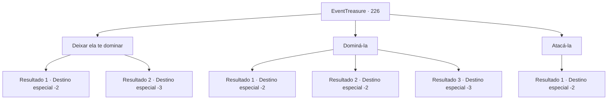

# Eventos de tesouro · 226

[Índice da tabela](index.md) · [Índice geral](../index.md)

ID: `pt:EventTreasure:226` · Fonte: `EventTreasure4` · Versão: 1.2.47.

Mapeamento estático dos arquivos; a disponibilidade e a execução dependem do estado da run.

## Texto do evento

*Sem texto no arquivo.*

## Dados de entrada

```json
{
  "id": 226,
  "grade": 1,
  "place": "",
  "required": ""
}
```

## Mapa das escolhas



## Escolhas e resultados

### Escolha 1

Deixar ela te dominar

Requisitos e outros campos da escolha:

```json
{
  "required": ""
}
```

#### Resultado 1.1

Deixe que a súcubo te tome e faça o que quiser. Ela coloca um sorriso suave e se envolve ao redor do seu corpo. 

 O sol nasce e você acorda muito cansado. A pessoa com quem você passou uma noite intensa não está em lugar nenhum. Depois de arrumar a desconfortável sacola de dormir, você se levanta. Em seguida, você guarda sua barraca e começa sua aventura novamente.

Continuação registrada: [Destino especial `-2`](../destinos-especiais.md).

```json
{
  "required": "1_0_2",
  "chance": "1",
  "nextEvent": -2,
  "type": 2,
  "reward": "0_0_-1|5_528_9"
}
```

#### Resultado 1.2

Deixe que a súcubo tome o seu corpo. Como se misturasse ferozmente com você, drena sua essência no processo. Você acaba desmaiando depois de terem drenado demais a sua essência.

Continuação registrada: [Destino especial `-3`](../destinos-especiais.md).

```json
{
  "required": "2_0_2",
  "chance": "1",
  "nextEvent": -3,
  "type": 2,
  "reward": "0_0_-1|5_528_9"
}
```

### Escolha 2

Dominá-la

Requisitos e outros campos da escolha:

```json
{
  "required": ""
}
```

#### Resultado 2.1

Conversas com a súcubo através de uma linguagem corporal intensa. Após horas de luta, você saiu vitorioso contra a súcubo, e a derrotada jaz no chão sem fôlego. 

 "Gemido. gemido... Nunca pensei que seriam me acuado assim..."

 Após se recuperar, a súcubo olha para você com olhos de interesse. Em seguida, estende a mão, segura suas bochechas e te beija. Após o beijo, a súcubo sorri e diz. 

 "Foi divertido. Nos vemos na próxima vez."

 Então voa em direção à escuridão da noite.

Continuação registrada: [Destino especial `-2`](../destinos-especiais.md).

```json
{
  "required": "",
  "chance": "1|0_13_1|0_12_1",
  "nextEvent": -2,
  "type": 0,
  "reward": "0_0_1|0_1_1|5_528_2"
}
```

#### Resultado 2.2

Você se comunica com a succubus através de uma linguagem corporal intensa. Mas talvez você tenha exagerado porque se sente extremamente exausto. Finalmente, você adormece sem poder resistir às suas pálpebras pesadas. 

 O sol nasce e você acorda muito cansado. A pessoa com quem você passou uma noite intensa não está em lugar nenhum. Depois de arrumar o desconfortável saco de dormir, você se levanta. Em seguida, você guarda sua barraca e começa sua aventura novamente.

Continuação registrada: [Destino especial `-2`](../destinos-especiais.md).

```json
{
  "required": "1_0_2",
  "chance": "24",
  "nextEvent": -2,
  "type": 1,
  "reward": "0_0_-1|5_528_9"
}
```

#### Resultado 2.3

Conversas com a succubus através de uma linguagem corporal intensa. Mas talvez tenhas exagerado porque te sentes extremamente exausto. Finalmente, adormeces sem poder resistir às tuas pálpebras pesadas. Então nunca mais voltas a abrir os olhos.

Continuação registrada: [Destino especial `-3`](../destinos-especiais.md).

```json
{
  "required": "2_0_2",
  "chance": "24",
  "nextEvent": -3,
  "type": 1,
  "reward": "0_0_-1"
}
```

### Escolha 3

Atacá-la

Requisitos e outros campos da escolha:

```json
{
  "required": ""
}
```

#### Resultado 3.1

Atacas a súcubo. Assustada, ela grita e desaparece na escuridão.

Continuação registrada: [Destino especial `-2`](../destinos-especiais.md).

```json
{
  "required": "",
  "chance": "1",
  "nextEvent": -2,
  "type": 2,
  "reward": "5_528_9"
}
```

## Referências que chegam a este evento

- [Evento 225 · escolha 1 · resultado 1](0225.md#escolha-1)
- [Evento 225 · escolha 1 · resultado 4](0225.md#escolha-1)
