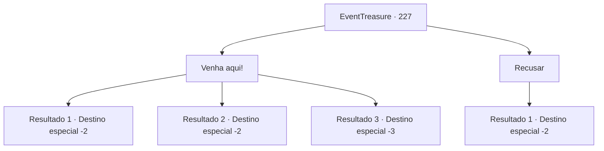

# Eventos de tesouro · 227

[Índice da tabela](index.md) · [Índice geral](../index.md)

ID: `pt:EventTreasure:227` · Fonte: `EventTreasure4` · Versão: 1.2.47.

Mapeamento estático dos arquivos; a disponibilidade e a execução dependem do estado da run.

## Texto do evento

Depois de adormecer, você sente alguém parado na sua frente. É o mesmo sentimento de quando a súcubo veio até você antes. Como esperado, você abre os olhos apenas para encontrar a mesma súcubo que conheceu antes, e há outras súcubos ao seu redor. 

 "Já faz um tempinho. {1}. Hehe... Estas são minhas amigas súcubos. Quando contei a elas sobre você, todas ficaram bem curiosas."

 As súcubos olham para você com um sorriso sedutor. 

 "Você pode nos dar um momentinho, certo?"


## Dados de entrada

```json
{
  "id": 227,
  "grade": 2,
  "place": "",
  "required": "5_528_2|26_5_1"
}
```

## Mapa das escolhas



## Escolhas e resultados

### Escolha 1

Venha aqui!

Requisitos e outros campos da escolha:

```json
{
  "required": ""
}
```

#### Resultado 1.1

Você passa uma noite intensa com as súcubos. Depois de se revirar por horas, você sobrevive nas ondas de carne. 

 "Oh, meu Deus... Isso é algo novo para mim..."

 Quando uma delas começa a murmurar, a súcubo que te apresentou sorri satisfeita e diz. 

 "Viu...? Eu não te disse?"

 Depois de um tempo, as súcubos que estavam deitadas começam a se levantar. Elas te olham com olhos surpresos. 

 "Agora. Por favor, aceite isso. É uma recompensa por nos proporcionar um bom momento."

 As súcubos se aproximam uma por uma e começam a respirar sua energia em você. A pegajosa energia rosa se infiltra em você e você se sente renovado e revigorado. 

 "Então, adeus."

 Depois de dizer isso, as súcubos desaparecem na escuridão como se estivessem se dissipando.

Continuação registrada: [Destino especial `-2`](../destinos-especiais.md).

```json
{
  "required": "",
  "chance": "1|0_13_1|0_12_1",
  "nextEvent": -2,
  "type": 0,
  "reward": "27_25_1|5_528_9|0_2_1"
}
```

#### Resultado 1.2

Você se comunica com as súcubos através de uma linguagem corporal intensa. Mas talvez você tenha exagerado porque se sente extremamente exausto. Finalmente, você adormece sem poder resistir às suas pálpebras pesadas. 

 O sol nasce e você acorda muito cansado. A pessoa com quem você passou uma noite intensa não está em lugar nenhum. Depois de arrumar o desconfortável saco de dormir, você se levanta. Em seguida, você guarda sua barraca e começa sua aventura novamente.

Continuação registrada: [Destino especial `-2`](../destinos-especiais.md).

```json
{
  "required": "1_0_2",
  "chance": "24",
  "nextEvent": -2,
  "type": 1,
  "reward": "0_0_-1|5_528_9"
}
```

#### Resultado 1.3

Você se comunica com as súcubos através de uma linguagem corporal intensa. Mas talvez você tenha exagerado porque se sente extremamente exausto. Finalmente, você adormece sem conseguir resistir às suas pálpebras pesadas. Então você nunca mais abre os olhos.

Continuação registrada: [Destino especial `-3`](../destinos-especiais.md).

```json
{
  "required": "2_0_2",
  "chance": "24",
  "nextEvent": -3,
  "type": 1,
  "reward": "0_0_-1"
}
```

### Escolha 2

Recusar

Requisitos e outros campos da escolha:

```json
{
  "required": ""
}
```

#### Resultado 2.1

Você rejeita a sedução das súcubos. Elas lambem seus lábios com decepção e desaparecem na escuridão.

Continuação registrada: [Destino especial `-2`](../destinos-especiais.md).

```json
{
  "required": "",
  "chance": "1",
  "nextEvent": -2,
  "type": 2,
  "reward": "5_528_9"
}
```

## Referências que chegam a este evento

Nenhum `nextEvent` positivo da mesma tabela aponta para este nó. Isso não prova que seja inacessível: sorteio e estado de história podem selecioná-lo.

