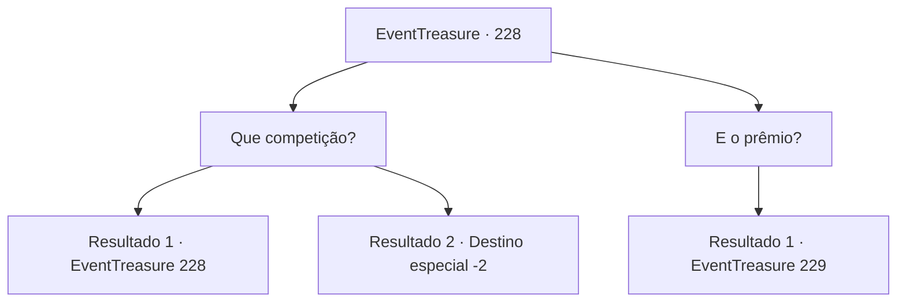

# Eventos de tesouro · 228

[Índice da tabela](index.md) · [Índice geral](../index.md)

ID: `pt:EventTreasure:228` · Fonte: `EventTreasure4` · Versão: 1.2.47.

Mapeamento estático dos arquivos; a disponibilidade e a execução dependem do estado da run.

## Texto do evento

|drawing_altena| Você visita uma cidade chamada ‘Altena’ localizada no topo de uma montanha rochosa. Esta cidade que serve um deus da sabedoria é famosa pelo templo de pedra construído no centro da cidade e pelas suas azeitonas de alta qualidade. A cidade é muito movimentada e você descobre o motivo na praça da cidade. Há um grupo de homens de aparência saudável lá, e uma pessoa está procurando seus nomes. O homem de meia-idade, um pouco careca, que estava anotando seus nomes, vem falar com você. 

 "Você deve estar participando desta competição também, suponho?"


## Dados de entrada

```json
{
  "id": 228,
  "grade": 2,
  "place": "",
  "required": "5_529_0|1_2_50|26_6_1"
}
```

## Mapa das escolhas



## Escolhas e resultados

### Escolha 1

Que competição?

Requisitos e outros campos da escolha:

```json
{
  "required": "5_530_0"
}
```

#### Resultado 1.1

Com a sua pergunta, ele responde com uma expressão confusa. 

 "Eu errei? Hmm, você parece muito saudável, que tal competir? Em breve, acontecerá a famosa 'Competição do Homem de Ferro' de Altena. Você conhece o ditado 'Mente sã em corpo são'?"

 Ele divaga sobre a competição que acontece em Altena. Resumindo, é uma competição organizada para honrar o deus da sabedoria, e uma competição para ver quem consegue chegar ao topo de 'Turdaran', a montanha rochosa nos arredores da cidade.

Continuação registrada: [Evento 228](0228.md) na mesma tabela.

```json
{
  "required": "1_13_14",
  "chance": "1",
  "nextEvent": 228,
  "type": 2,
  "reward": "5_530_1|5_529_1"
}
```

#### Resultado 1.2

Em resposta à sua pergunta, ele te examina e diz: 

 "Hmm... O 'Iron Man Competition', nosso orgulhoso evento em Altena, acontecerá em breve. Parece um pouco desafiador para você participar da competição... Se tiver tempo, talvez queira ver."

 No entanto, você rejeita sua sugestão e segue para outro lugar.

Continuação registrada: [Destino especial `-2`](../destinos-especiais.md).

```json
{
  "required": "2_13_14",
  "chance": "1",
  "nextEvent": -2,
  "type": 2,
  "reward": "5_530_9|5_529_1"
}
```

### Escolha 2

E o prêmio?

Requisitos e outros campos da escolha:

```json
{
  "required": "5_530_1"
}
```

#### Resultado 2.1

Ele responde à sua pergunta com uma risada sincera. 

 "Hahaha! Você é honesto! O vencedor receberá o título de 'Homem de Ferro'. E também será concedida uma 'recompensa suculenta'. O que você acha? Gostaria de participar? A taxa de participação é de 30 moedas de ouro."


Continuação registrada: [Evento 229](0229.md) na mesma tabela.

```json
{
  "required": "",
  "chance": "1",
  "nextEvent": 229,
  "type": 2,
  "reward": ""
}
```

## Referências que chegam a este evento

- [Evento 228 · escolha 1 · resultado 1](0228.md#escolha-1)
