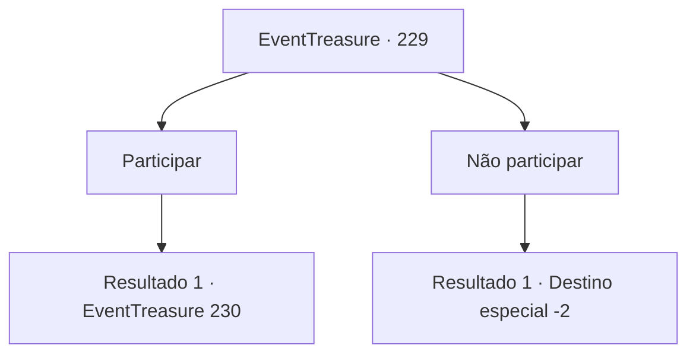

# Eventos de tesouro · 229

[Índice da tabela](index.md) · [Índice geral](../index.md)

ID: `pt:EventTreasure:229` · Fonte: `EventTreasure4` · Versão: 1.2.47.

Mapeamento estático dos arquivos; a disponibilidade e a execução dependem do estado da run.

## Texto do evento

*Sem texto no arquivo.*

## Dados de entrada

```json
{
  "id": 229,
  "grade": 1,
  "place": "",
  "required": ""
}
```

## Mapa das escolhas



## Escolhas e resultados

### Escolha 1

Participar

Requisitos e outros campos da escolha:

```json
{
  "required": "1_4_30"
}
```

#### Resultado 1.1

Decide participar na competição para selecionar o Homem de Ferro. A recepcionista anota seu nome no pergaminho e pega seu ouro. 

 "Só estou te dizendo por precaução, mas você deve chegar ao topo de Turdaran apenas com sua força física. Você será desqualificado se usar magia."

 Depois de dar as precauções, a recepcionista sobe ao palco e fala com as pessoas reunidas. 

 "Agora. Coloque-se na linha de partida. Haverá bandeiras no caminho, então você pode seguir as bandeiras e chegar ao topo de Turdaran. Agora! Chega de explicações! Comece!"

 Assim que termina de falar, o som do chifre toca, anunciando o início da competição. Então, as pessoas começam a correr para a frente.

Continuação registrada: [Evento 230](0230.md) na mesma tabela.

```json
{
  "required": "",
  "chance": "1",
  "nextEvent": 230,
  "type": 2,
  "reward": "5_529_1|0_4_-30"
}
```

### Escolha 2

Não participar

Requisitos e outros campos da escolha:

```json
{
  "required": ""
}
```

#### Resultado 2.1

Decide não participar da seleção do Homem de Ferro. A recepcionista se aproxima de outra pessoa depois de ouvir sua resposta, você se afasta da praça lotada.

Continuação registrada: [Destino especial `-2`](../destinos-especiais.md).

```json
{
  "required": "",
  "chance": "1",
  "nextEvent": -2,
  "type": 2,
  "reward": "5_529_9"
}
```

## Referências que chegam a este evento

- [Evento 228 · escolha 2 · resultado 1](0228.md#escolha-2)
